## Organ failure is the rule, not the exception, in patients who most need effective antimicrobials

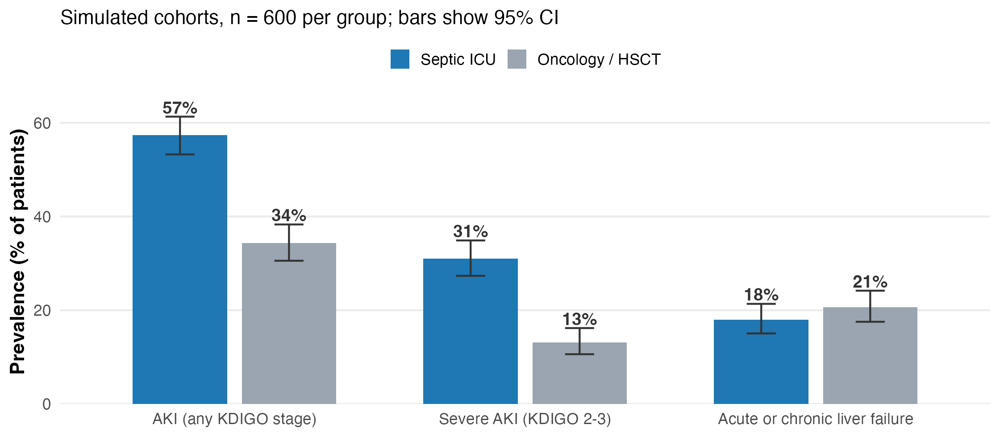{fig-alt="Bar chart of AKI and liver failure prevalence in septic ICU and oncology populations" height=450}

::: {.source}
Simulated cohorts (illustrative). AKI in ICU patients: [@hoste2015]. Cirrhosis with septic shock: [@galbois2014]. Bacteremia in cirrhosis: [@arvaniti2010]
:::

::: {.takeaway}
AKI affects more than half of ICU patients (57%). In cirrhosis with septic shock, in-ICU mortality is 65–70%. We dose these patients every day — usually with assumptions that don't apply.
:::

::: notes
The framing point: this isn't a niche population. In the AKI-EPI study 57% of
ICU patients had AKI by KDIGO criteria (all ICU patients, not septic patients only).
In a 32-ICU Paris cohort, in-ICU mortality in cirrhotic patients with septic shock
was 70% overall and 65% by 2010 (Galbois). For cirrhosis with bacteremia outside the
ICU setting, a meta-analysis gives a median mortality of 42% (Arvaniti).
If our dosing is wrong in these patients, we are dosing wrong in a large fraction
of the patients who most need correct dosing. Placeholder bar chart here — I'll
replace with KDIGO and EASL-CLIF prevalence figures.
:::

## Empirical "renal and hepatic dose adjustment" tables systematically miss the target in critically ill patients

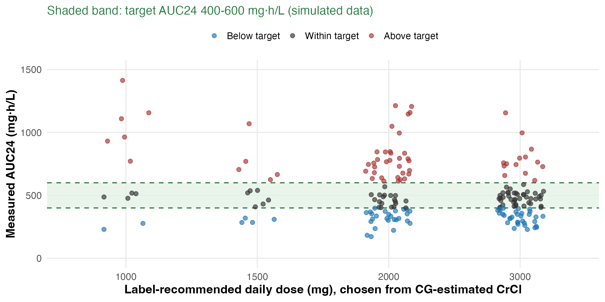{fig-alt="Scatter of measured AUC vs label-recommended dose with target band" height=520}

::: {.source}
Simulated data (illustrative). Concept after [@roberts2014]
:::

::: notes
This is the rhetorical hook. Label-recommended adjustment tables were derived
mostly from stable outpatients with measured GFR. When you take a real ICU
cohort and measure exposure on those doses, a striking fraction sit outside
the PK/PD target — often below. In DALI, 16% of the 248 patients treated for infection
did not reach 50% fT>MIC on standard regimens, and these patients were 32% less likely
to have a positive clinical outcome. Replace placeholder
with a DALI-style scatter or a Roberts/Lipman summary figure.
:::

# PK/PD framework {background-color="#1f3a5f"}

## Antibiotic efficacy is governed by three PK/PD indices that respond differently to organ dysfunction

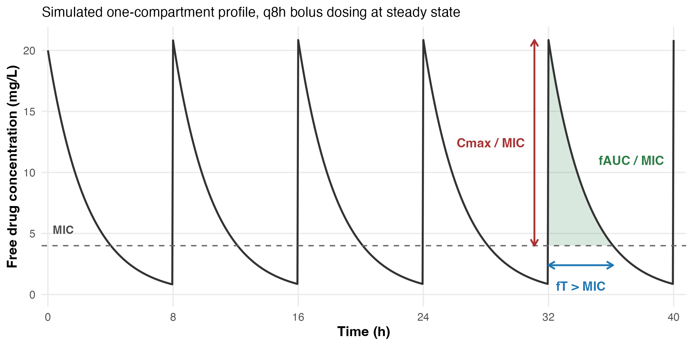{fig-alt="Concentration-time curve annotated with Cmax/MIC, fAUC/MIC, fT>MIC" height=520}

::: {.source}
Simulated profile (illustrative). PK/PD indices after [@craig1998]
:::

::: notes
Three classes of indices. Concentration-dependent (aminoglycosides, Cmax/MIC),
exposure-dependent (vancomycin, fluoroquinolones, fAUC/MIC), and time-dependent
(β-lactams, fT>MIC). The reason these distinctions matter for organ failure is
that they respond differently to changes in clearance. A β-lactam in a patient
with low clearance suddenly looks great by fT>MIC and terrible by toxicity; a
fluoroquinolone in ARC looks great by Cmax and terrible by AUC. Same patient,
different drug, opposite answer. This is the slide I'll come back to throughout
the talk.
:::

## Only the unbound fraction of drug crosses membranes and binds its target

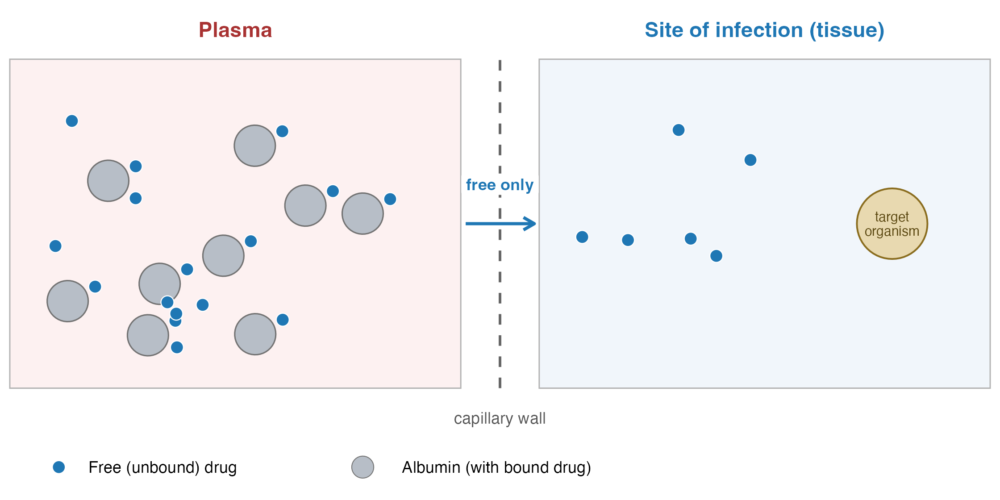{fig-alt="Schematic showing free vs bound drug at site of infection" height=450}

::: {.source}
Schematic with simulated molecule positions (illustrative). Concept after [@zeitlinger2011; @ulldemolins2011]
:::

::: {.takeaway}
Total-drug concentrations are a *convenience measurement*. Free drug is the pharmacology.
:::

::: notes
This is the conceptual foundation for slides 14 and 15. Every PK/PD target in
the literature should technically be expressed as free drug. For drugs with low
protein binding (<30%), the distinction barely matters. For drugs with high
binding — ceftriaxone 95%, ertapenem 95%, flucloxacillin 95%, teicoplanin 90% —
small changes in binding mean large changes in free fraction, and total-drug
TDM becomes unreliable. We'll quantify this in the protein-binding section.
:::

# Kidney failure {background-color="#1f3a5f"}

## Renal dysfunction prolongs the half-life of renally cleared antibiotics in proportion to lost GFR

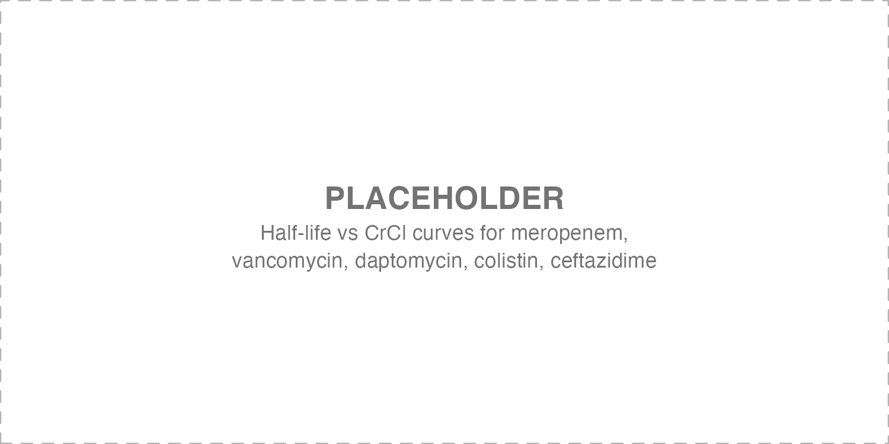{fig-alt="Half-life vs CrCl curves for meropenem, vancomycin, daptomycin, colistin, ceftazidime" height=520}

::: {.source}
Placeholder; to be drawn from [@verbeeck2009]
:::

::: notes
Standard teaching, but the visual reinforces the heterogeneity. Note the
fan-out at low CrCl — half-lives separate by factors of 5 to 10. This is also
where label-recommended doses diverge most. Replace placeholder with overlaid
curves; the meropenem and ceftazidime data are well-published (Thalhammer,
Verbeeck). If I can get matched daptomycin + colistin curves, the dispersion
illustrates the point that "renal dose adjustment" is not one decision.
:::

## Creatinine-based GFR estimates are unreliable in the critically ill and frequently misclassify clearance

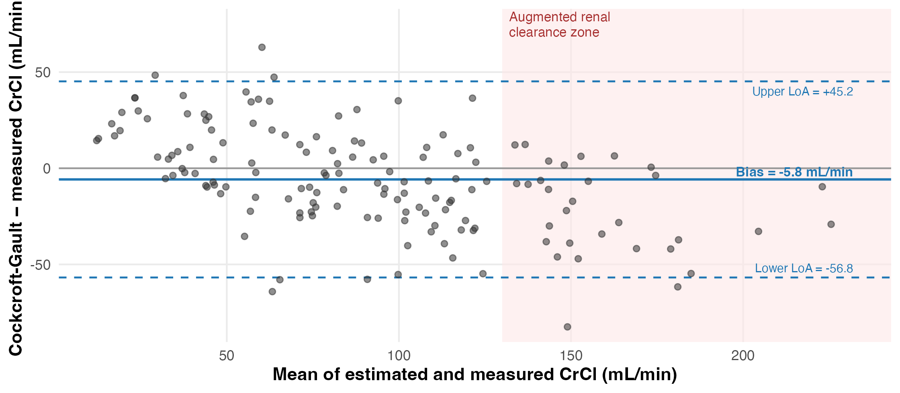{fig-alt="Bland-Altman plot comparing Cockcroft-Gault to measured 8-h CrCl in ICU patients" height=450}

::: {.source}
Simulated data (illustrative). Pattern after [@udy2014; @baptista2014]
:::

::: {.takeaway}
Limits of agreement span > 100 mL/min. Systematic underestimation in ARC. Cockcroft-Gault was never meant for the unstable patient.
:::

::: notes
This is one of the two figures I want you to take a photo of. The bias is
modest in the middle range and a bedside clinician might call it acceptable.
But look at the limits of agreement — over 100 mL/min wide. That means if I
hand you a CG-estimated CrCl of 80, the true value is somewhere between 30 and
130. You cannot dose meropenem or vancomycin off that number with any
confidence. The systematic underestimation in the ARC zone — right side, red
shading — is the second problem: every estimate underestimates ARC, so we
systematically underdose the patients with the highest clearance. Baptista,
Udy, and others have shown this repeatedly. Solution is urinary 8h CrCl when
the patient is catheterized — which is most of the ICU.
:::

## Augmented renal clearance produces sub-therapeutic exposure in up to half of younger septic patients

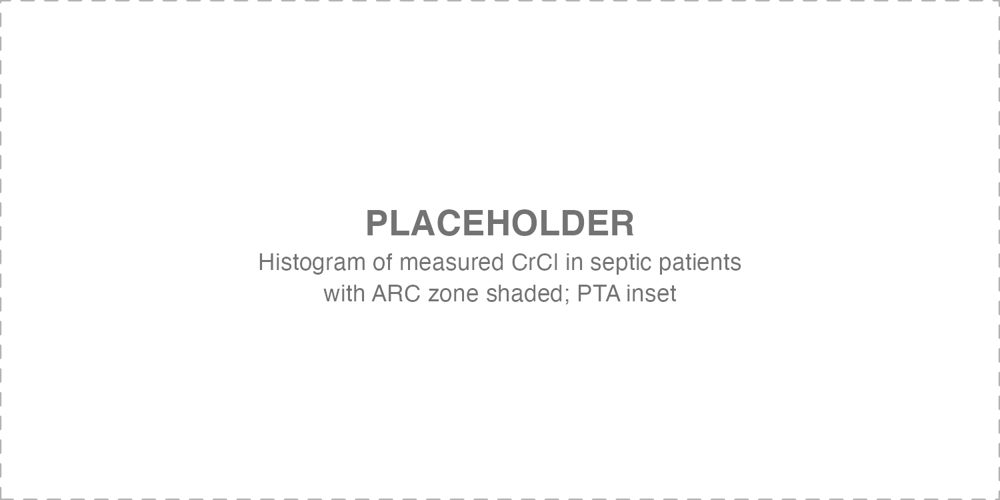{fig-alt="Histogram of measured CrCl in septic patients with ARC zone shaded; PTA inset" height=520}

::: {.source}
Placeholder; ARC prevalence from [@udy2014; @claus2013; @hefny2022]
:::

::: notes
ARC, defined as measured CrCl > 130 mL/min/1.73m², was present in 65% of ICU patients with normal
plasma creatinine on at least one day in week 1 (Udy), 52% of a mixed ICU population on
antibiotics (Claus), and 39% pooled across 70 studies (Hefny), ranging from 33% in sepsis
ICUs to 58% in trauma and 74% in neuro ICUs. The
histogram I'll put here should show the mode of the population sitting in the
ARC zone, which makes the point viscerally. The inset Monte Carlo result —
percentage attaining fT>MIC on standard meropenem dosing in ARC patients —
typically sits below 50%. The actionable point: ARC is the opposite problem
to renal failure, but it is much more common in the ICU and we routinely miss
it.
:::

## Drug removal during CRRT depends on modality, effluent rate, sieving coefficient, and protein binding — not on the dialyzer alone

{fig-alt="Schematic of CVVH vs CVVHDF with sieving-coefficient equation overlay" height=400}

::: {.source}
Placeholder; sieving coefficients from [@churchwell2006; @matzke2000; @kortge2021]. Dosing reviews: [@dewaele2014; @trotman2005]
:::

::: {.takeaway}
CL~CRRT~ ≈ Q~effluent~ × S~c~. Highly protein-bound or low-S~c~ drugs are barely removed; meropenem, β-lactams, vancomycin: substantial removal at modern effluent rates.
:::

::: notes
The two things to internalize here. First, modern CRRT effluent rates (25-35
mL/kg/h, often higher than prescribed because of downtime) result in
clearances of 25-50 mL/min for highly diffusible drugs. That is a non-trivial
fraction of normal renal clearance. Second, the sieving coefficient drives
who actually gets cleared. In vitro, meropenem has a sieving coefficient of about
0.7-1.0 (Körtge), daptomycin 0.14-0.20 (Churchwell, Körtge). For ceftriaxone only the
sieving coefficient of the unbound drug is reported (0.5-0.9, Matzke) and only 16-30%
of it is unbound, so total-drug removal is much lower. So a vague instruction to "halve the dose for CRRT" can be wrong by a
factor of ten. The Pea/Roberts equations let you do this estimate at the
bedside. I'll keep the equation small and make the modality schematic the
focus.
:::

## Loading doses depend on volume of distribution and must not be reduced for renal dysfunction

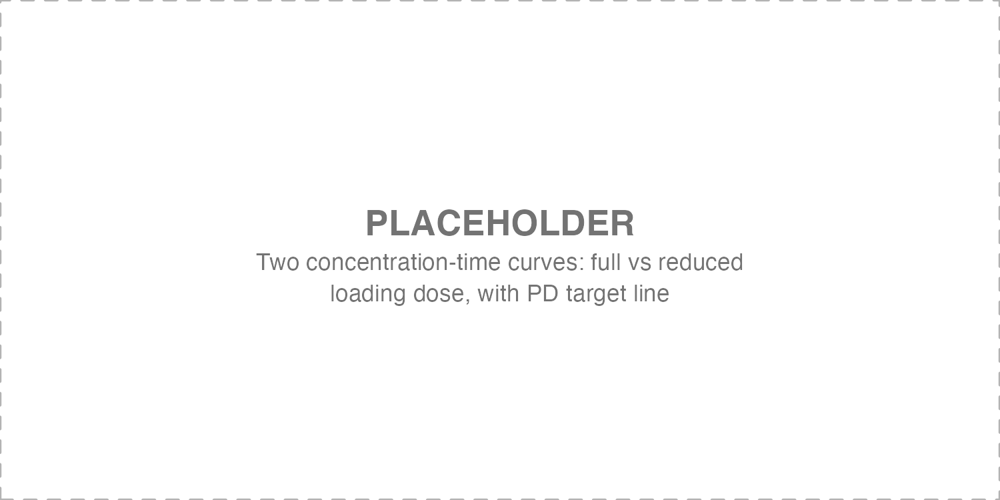{fig-alt="Two concentration-time curves: full vs reduced loading dose, with PD target line" height=400}

::: {.source}
Placeholder; simulated curves to follow [@roberts2009]
:::

::: {.takeaway}
Loading dose is a function of Vd, not of CL. Reducing it delays target attainment by 1–3 half-lives.
:::

::: notes
This is the one bit of teaching that most undergraduate pharmacy curricula get
wrong and most clinicians inherit. The loading dose is determined by the
desired concentration and the volume of distribution: D~load~ = C~target~ × Vd.
Renal dysfunction does not shrink Vd — if anything it expands it via fluid
overload, capillary leak, hypoalbuminemia. Reducing the loading dose for
"renal failure" simply delays target attainment by one to three half-lives —
which in a septic patient is exactly when target attainment matters most. I'll
show two simulated curves: full loading dose hitting target within 4 hours,
reduced loading dose not crossing target for 24+ hours.
:::

# Liver failure {background-color="#1f3a5f"}

## Cirrhosis alters drug exposure through four parallel mechanisms that do not move together

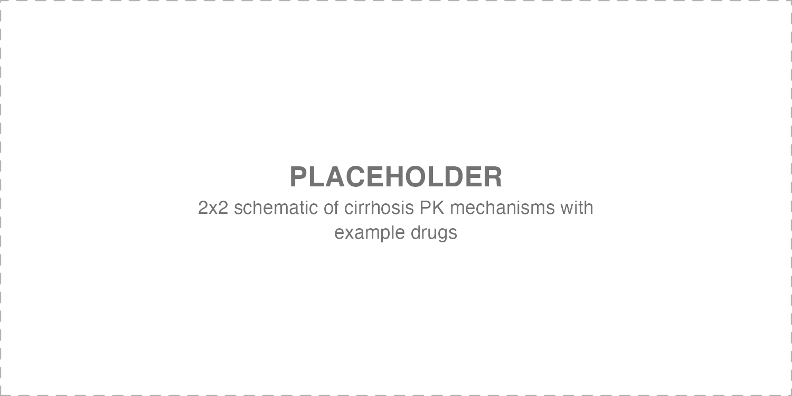{fig-alt="2x2 schematic of cirrhosis PK mechanisms with example drugs" height=520}

::: {.source}
Placeholder; to be drawn from [@verbeeck2008]
:::

::: notes
A 2×2 grid: reduced CYP/phase-II activity, expanded Vd (ascites/edema),
hypoalbuminemia, biliary stasis. Example drugs in each quadrant — tigecycline
(metabolism), ceftriaxone (binding + biliary), moxifloxacin (metabolism +
QT), micafungin (biliary, but largely safe). The point of showing them as
parallel mechanisms is that they do not correlate — a patient can have
normal CYP function and severe hypoalbuminemia, or vice versa, and the dosing
implication is different. This is why a single Child-Pugh class is too coarse
to drive dosing.
:::

## Child-Pugh class predicts mortality better than it predicts pharmacokinetics

{fig-alt="Scatter of clearance vs Child-Pugh score for 2-3 hepatically cleared drugs" height=400}

::: {.source}
Placeholder; to be drawn from [@verbeeck2008]
:::

::: {.takeaway}
Within each Child-Pugh class, drug clearance spans 3–10× — far wider than between classes.
:::

::: notes
Child-Pugh was derived as a prognostic score for surgical mortality. It
correlates with PK on average, but the within-class variability is enormous.
Voriconazole clearance in Child-Pugh B patients spans about an order of
magnitude. Tigecycline AUC roughly doubles between A and C, but with
considerable overlap. So Child-Pugh is a starting point — it tells you that
adjustment is needed and which direction — but it cannot tell you how much.
For drugs with TDM (voriconazole, isavuconazole), measure. For drugs without,
expect wide variability and consider conservative starting doses with early
clinical reassessment.
:::

## Hepatorenal syndrome compounds elimination defects and converts a "hepatic" drug problem into a renal one

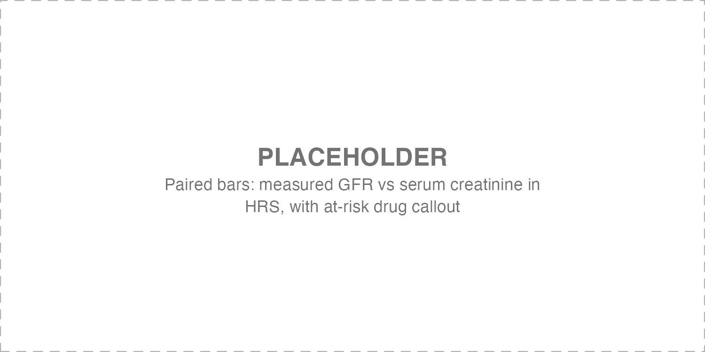{fig-alt="Paired bars: measured GFR vs serum creatinine in HRS, with at-risk drug callout" height=520}

::: {.source}
Placeholder; to be drawn from [@angeli2015]
:::

::: notes
The clinical trap. HRS patients have markedly reduced GFR — often below 30
mL/min — but their serum creatinine looks deceptively reasonable because of
reduced muscle mass and reduced hepatic creatine synthesis. So the
estimated CrCl from Cockcroft-Gault overestimates real clearance by a factor
of two or more. If you reach for a renally cleared antibiotic — aminoglycoside,
vancomycin, polymyxin — in a cirrhotic patient with HRS, the standard renal
adjustment tables will systematically overdose. Cystatin C is more reliable in
this population, or measured CrCl when possible.
:::

# Protein binding {background-color="#1f3a5f"}

## Hypoalbuminemia raises the free fraction of highly bound antibiotics, but also accelerates their clearance

{fig-alt="Two panels: free fraction vs albumin (rising); clearance vs albumin (rising)" height=400}

::: {.source}
Placeholder; to be drawn from [@ulldemolins2011; @zeitlinger2011]
:::

::: {.takeaway}
For ceftriaxone, ertapenem, flucloxacillin, teicoplanin: free AUC may be preserved despite hypoalbuminemia. Reflexive dose escalation is often wrong.
:::

::: notes
This is the most counter-intuitive slide in the talk. When albumin falls, the
free fraction of a highly bound drug rises — that part is obvious. What is
less obvious is that for many drugs the total clearance also rises, because
clearance of the unbound fraction is unchanged but a larger proportion is
unbound and available for elimination. The net effect on free AUC is often
near-zero — sometimes slightly higher, sometimes lower. So the right answer
to "low albumin, what do I do with the ceftriaxone dose" is usually "nothing"
— unless the patient is also volume-resuscitated, in which case Vd is the
larger driver. The point is that the answer requires thinking, not a reflex.
:::

## For highly protein-bound antibiotics, total-drug TDM can mislead and free-drug measurement matters

{fig-alt="Side-by-side total vs free concentration-time curves, total therapeutic, free sub-target" height=520}

::: {.source}
Placeholder; to be drawn from [@ulldemolins2010; @zeitlinger2011]
:::

::: notes
The clinical extension. If you do measure ceftriaxone or flucloxacillin TDM in
a hypoalbuminemic patient, the total concentration can look reassuringly
in-range while the free concentration sits below MIC. This has been
documented in critically ill flucloxacillin patients with endocarditis.
Practical implication: when you have access to free-drug measurement and the
patient has albumin <25 g/L and is on a highly bound antibiotic, measure the
free fraction. When you don't have access, assume the free fraction is
higher than predicted by population PK and lean on clinical response.
:::

# Optimization {background-color="#1f3a5f"}

## Extended and continuous infusion of β-lactams achieves PK/PD targets that intermittent dosing cannot in patients with altered Vd

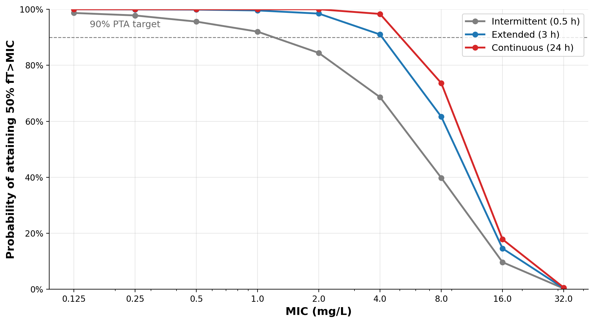{fig-alt="Monte Carlo PTA curves for meropenem intermittent vs extended vs continuous infusion" height=400}

::: {.source}
Monte Carlo simulation (illustrative). Trials: [@monti2023; @dulhunty2024]
:::

::: {.takeaway}
At MIC 4–8 mg/L — the breakpoint zone — intermittent dosing fails the 90% PTA target while extended and continuous infusion clear it.
:::

::: notes
This is the second figure I want you to take a photo of. Monte Carlo
simulation, 5000 virtual ICU patients with realistic BSV on CL and Vd, target
50% fT>MIC. At low MIC, everything works. At MIC ≥4 — which includes the
EUCAST breakpoint for Pseudomonas at 2 — intermittent dosing falls below the
90% PTA target while extended and continuous infusion remain above. The
difference between extended and continuous is modest; the difference from
intermittent is large. This is the strongest practical argument for prolonged
infusion. The recent BLING-III and MERCY trials have given us large RCT data
supporting this; while not unanimous, the PK/PD case is robust.
:::

## Bayesian model-informed precision dosing translates measured concentrations into individualized regimens at the bedside

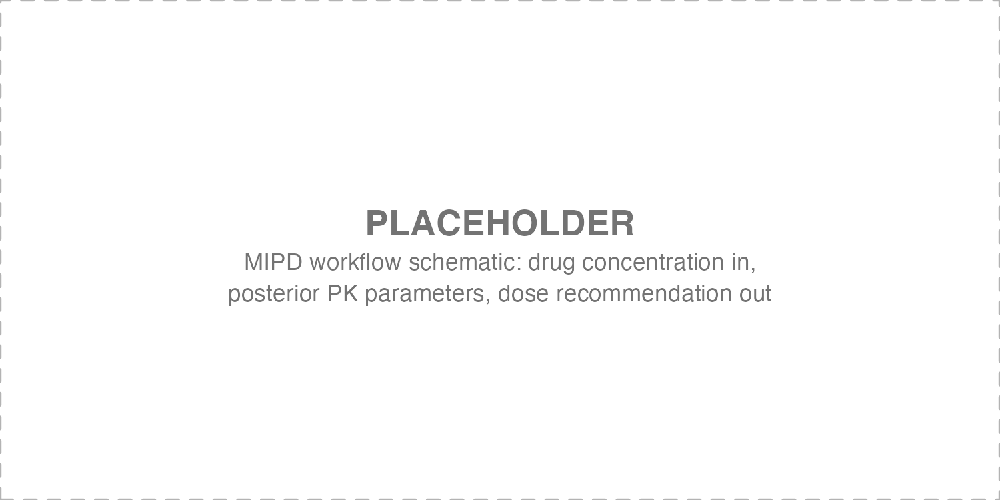{fig-alt="MIPD workflow schematic: drug concentration in, posterior PK parameters, dose recommendation out" height=520}

::: {.source}
Placeholder; to be drawn from [@wicha2021]
:::

::: notes
MIPD is the operational answer to everything we've said so far. You start
with a population prior, you measure a concentration, the software computes
a posterior estimate of the patient's individual CL and Vd, and recommends a
next dose to hit the PD target. Tools: InsightRx, DoseMeRx, BestDose, the
open-source nlmixr2 + brms stack. The barrier is not the math — it is
workflow integration with the lab and the pharmacy. Centers that have made
this work (Antwerp, Liverpool, Rotterdam, ours in Padova) show measurable
improvement in target attainment. I'll show one anonymized case from our
practice — beta-lactam dose individualization on day 2 of a CRRT patient.
:::

## A practical bedside algorithm anchors dosing in five questions

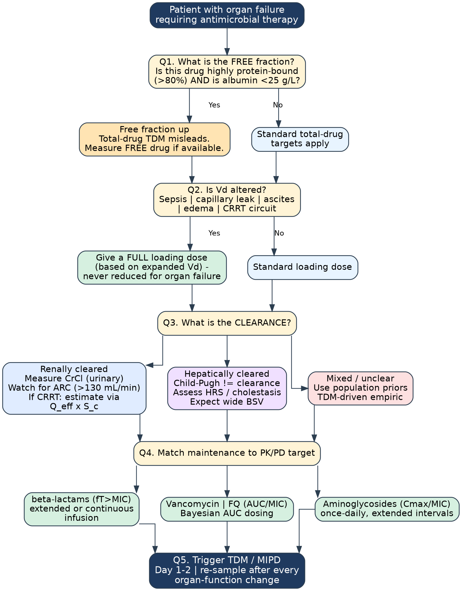{fig-alt="Five-question decision algorithm for antimicrobial dosing in organ failure" height=520}

::: {.source}
Author's synthesis of the preceding slides
:::

::: notes
The synthesis slide. Five questions in order. First: what is the free
fraction? Highly bound drug + low albumin = use free-drug targets. Second:
is Vd altered? Sepsis, capillary leak, CRRT — give a full loading dose.
Third: what is the clearance? Renal, hepatic, mixed, and the diagnostic
pathway differs. Fourth: match maintenance to the PK/PD index — fT>MIC means
prolonged infusion, AUC/MIC means Bayesian dosing, Cmax/MIC means extended
intervals. Fifth: trigger TDM and MIPD on day 1 or 2, and re-sample after
any meaningful change in organ function. If you take one image home, take
this one.
:::

# Take-home {background-color="#1f3a5f"}

## Optimal antimicrobial dosing in organ failure requires individualization, not adjustment tables

{fig-alt="Composite take-home image" height=400}

::: {.source}
Author's synthesis of the preceding slides
:::

::: {.takeaway}
**Free-drug targets** matter when albumin is low and binding is high.\
**Loading doses** are governed by Vd — never reduce them for organ failure.\
**Maintenance doses** must match the PK/PD index and the measured clearance.\
**Extended or continuous infusion** of β-lactams should be the default in the ICU.\
**TDM + Bayesian MIPD** is the operational answer to all of the above.
:::

::: notes
Five things to take home. The talk has been one extended argument that
dose-adjustment tables are necessary but not sufficient in critically ill
patients with organ failure. Free-drug targets, full loading doses,
maintenance-dose matching to the PK/PD index, prolonged infusion, and TDM
with Bayesian dosing are the levers we have. None are exotic; all are
underused. Thank you — happy to take questions.
:::

## Acknowledgments and references {visibility="uncounted"}

::: {style="font-size: 0.7em;"}
**Collaborators**\
M. Stanzani, Treviso BMT Program · UniPD ID Section · JAC editorial colleagues
:::

::: {#refs style="font-size: 0.55em;"}
:::

<!-- Draft references not yet verified against Crossref (removed from the rendered list; check before restoring):
Hites M et al. Beta-lactams in CRRT. Crit Care 2014.
Baptista JP et al. CrCl in ICU. Crit Care 2011. (closest match found: Baptista, J Nephrol 2014, now in refs.bib)
Wong G et al. Protein binding in critical illness. J Antimicrob Chemother 2018.
Abdul-Aziz MH et al. BLING-III. JAMA 2024. (first author is Dulhunty; now in refs.bib)
-->

::: notes
Hold-slide for questions and references. Add JAC editorials and any local
data from the Padova / Treviso experience.
:::
