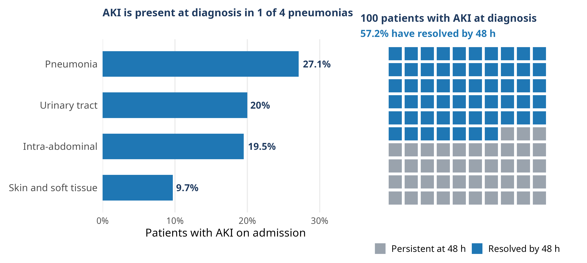
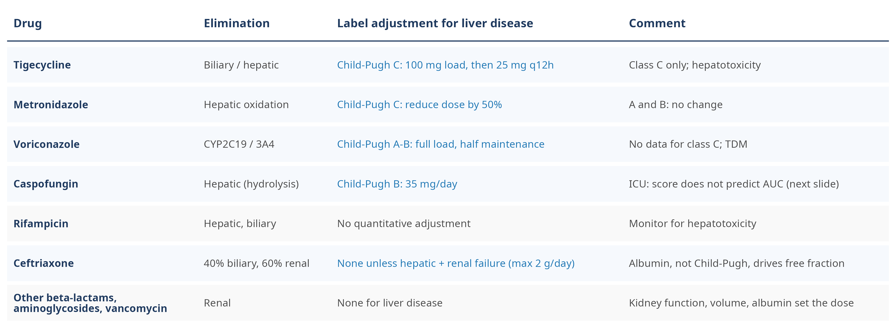
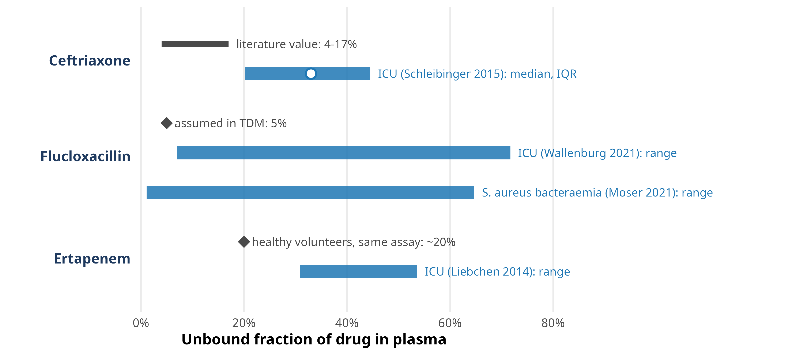
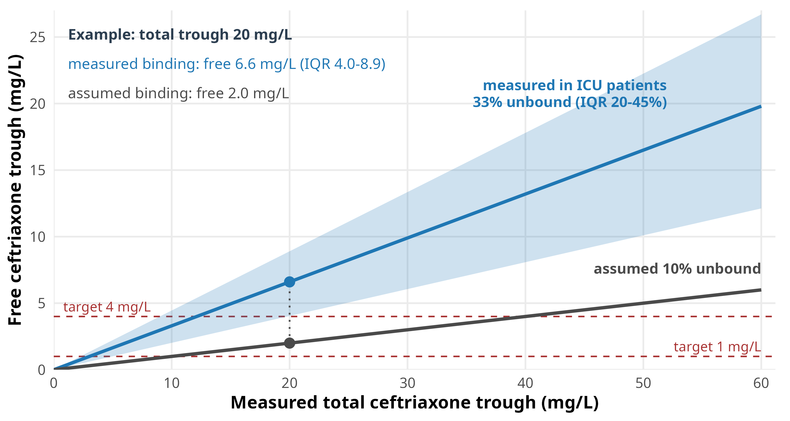
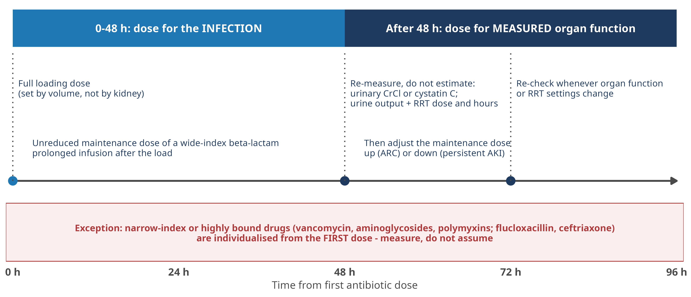

<!-- v2, revised 16 Nov 2026.
     13 content slides (about 22 min) + 2 uncounted backup slides (RRT; cirrhosis GFR) + references.
     Through-line: first 48 h dose for the infection; after 48 h dose for MEASURED organ function.
     Original contribution (slides 9-10): the false precision of fixed protein binding and how it
     could alter breakpoints and target attainment in PK/PD analysis.
     Figures: scripts 08-20 in this folder write figures/*.png; every plotted number is a published
     summary statistic except the clearly labelled simulation inset on slide 11 (script 11).
     One slide (creatinine equations) still carries a "Figure to draw" box: it needs the Baptista 2014
     full text; see the box for the two honest options.
     A hypothetical patient is introduced on slide 1 and revisited on slide 13. -->

## More than half of the acute kidney injury present when infection is diagnosed resolves within 48 hours

::: {.vignette}
**Hypothetical patient.** 58-year-old, alcohol-related cirrhosis (Child-Pugh B, albumin 22 g/L), septic shock from secondary peritonitis. Creatinine 2.1 mg/dL (baseline 0.8), no urine for 6 h. Meropenem is ordered; the renal-dosing table proposes 1 g q12h.
:::

{fig-alt="Icon array: of 100 patients with AKI at diagnosis of infection, 57 have resolved by 48 h; bars of admission AKI rate by infection type" height=400}

::: {.source}
Admission AKI and 48-h resolution: [@crass2019]. AKI in 57.3% of ICU patients: [@hoste2015]
:::

::: notes
Hook. Dose-adjustment tables come from stable chronic kidney disease; our patients have unstable kidney function. Crass 2019 abstract: AKI on admission in 27.1% (pneumonia), 19.5% (intra-abdominal), 20.0% (urinary), 9.7% (skin); resolved by 48 h in 57.2%. AKI-EPI: 1032 of 1802 ICU patients (57.3%, 95% CI 55.0-59.6) had AKI. In cirrhosis with septic shock, renal dysfunction was present in 71.5% vs 54.8% without cirrhosis (Galbois 2014). Introduce the patient: we will come back to her at 48 h on the last slide. Scope statement, said aloud: this talk is about β-lactams and the drugs where under-dosing is the main risk; the narrow-index drugs are the exception and come at the end.
:::

## Reducing β-lactam doses for kidney injury in the first 24–48 hours is associated with worse outcomes

{fig-alt="Left: cIAI clinical cure by baseline creatinine clearance in the ceftolozane/tazobactam and ceftazidime/avibactam registration trials, from the FDA labels. Right: hazard ratio for in-hospital death, late versus early renal dose adjustment, Aldardeer 2024" height=470}

::: {.source}
Label precautions (section 5.1): [@fda_zerbaxa2022; @fda_avycaz2025]; rationale: [@crass2019; @kullar2017]. Scoping review: [@horstink2025]. Cohort: [@aldardeer2024]
:::

::: notes
Be explicit that this is association, not proof. Start with the labels: both FDA labels carry a precaution that cIAI cure was lower at CrCl 30-50 mL/min: ceftolozane/tazobactam 47.8% (11/23) vs meropenem 69.2% (9/13), against 85.2% vs 87.9% above 50; ceftazidime/avibactam 45% (14/31) vs 74% (26/35). The ceftazidime/avibactam label adds that these patients received a 33% lower daily dose than is now recommended, so the renal adjustment itself was revised upward. Caveats to say aloud: small subgroups (36 and 66 patients); Kullar 2017 showed the ceftolozane difference disappears in the microbiologically evaluable population (72.7% vs 71.4%). Horstink 2025: 11 studies, 1,407 patients, high risk of bias; three studies linked delayed reduction to lower mortality, one linked early reduction to less neurotoxicity. Aldardeer 2024: prospective observational, 84 early vs 140 late adjusters, HR 0.588 (0.355-0.974). Applies to wide-therapeutic-index drugs only.
:::

## Creatinine-based equations get the average right and the individual patient wrong in critical illness

::: {.todo-fig}
**Figure to draw (needs the full text).** The abstract of Baptista 2014 gives only summary statistics (8-h measured CrCl vs Cockcroft-Gault: means 135.5 vs 135.7 mL/min/1.73 m², R = 0.2, precision ±40.9%); a scatter cannot be reconstructed from them honestly. Two options: (a) obtain the full text and digitise the published Bland-Altman panel, labelled "redrawn from Fig. X"; or (b) plot what the abstract supports: Hanna 2023 bars (cystatin C eGFR >30% below creatinine eGFR in 29%; vancomycin >30 mg/L in 24% vs 9%) with the Baptista statistics as a text panel. Do not simulate a scatter with the published R.
:::

::: {.source}
ICU agreement: [@baptista2014; @carlier2015]. Cystatin C and cefepime clearance: [@barreto2023]. Cancer cohort: [@hanna2023]
:::

::: notes
Baptista 2014: no difference in means (8-h CrCl 135.5 vs CG 135.7), but R = 0.2 and all equations underestimated when measured CrCl >120 and overestimated when <120. Carlier 2015 (inulin reference, n = 68): creatinine equations biased and imprecise; measured urinary CrCl overestimated GFR; cystatin C equations unbiased but still imprecise. Barreto 2023: eGFRcr-cysC was the best predictor of cefepime clearance (n = 120). Hanna 2023 (n = 1,869 cancer patients): eGFRcys >30% lower than eGFRcr in 29%; vancomycin >30 mg/L 24% vs 9%, adjusted OR 2.59 (1.08-7.03). Present measured CrCl and cystatin C as better, not as the answer.
:::

## Four in ten ICU patients have augmented renal clearance, which predicts sub-MIC β-lactam troughs

{fig-alt="Icon array of pooled ARC prevalence 39% and bars of beta-lactam troughs below MIC overall and in patients with CrCl at or above 130" height=470}

::: {.source}
Prevalence: [@hefny2022; @udy2014]. Exposure: [@udy2012; @abdulla2020; @wong2018]. Outcome with high-dose continuous infusion: [@carrie2018]
:::

::: notes
Udy 2012 (n = 52): trough >= MIC in only 58% overall; CrCl >= 130 associated with trough < MIC in 82% and < 4x MIC in 72% (subgroup size not in the abstract). Abdulla 2020 (EXPAT, n = 147): 63.3% attained 100% fT>MIC(ECOFF); eGFR >= 90 was a risk factor for non-attainment. Wong 2018: ARC raised the odds of missing 100% fT>MIC (OR 2.47). Carrie 2018: with high-dose continuous infusion the underdosing rate was 12%.
:::

## In kidney failure, overexposure is measurable harm: cefepime neurotoxicity tracks the trough concentration

{fig-alt="Median and interquartile range of cefepime trough in patients with and without neurotoxicity, with the 7.7 and 38.1 mg/L thresholds" height=460}

::: {.source}
Thresholds: [@boschungpasquier2020; @imani2017]. Randomised comparison: [@qian2023]
:::

::: notes
Balance slide: the first-48-h argument is not a licence for sustained overexposure. The figure shows medians and IQRs as reported; patient-level data are not public, so no points are drawn. Boschung-Pasquier 2020 (n = 319 with troughs): neurotoxicity in 23.2%; eGFR 35 vs 82 mL/min/1.73 m² in those with vs without neurotoxicity; 6.3 (4.1-8.6) vs 21.6 (17.0-28.6) mg/L; none below 7.7, all above 38.1. ACORN (n = 2,511): cefepime vs piperacillin-tazobactam, no difference in AKI or death (OR 0.95, 0.80-1.13); fewer days alive and free of delirium and coma with cefepime (OR 0.79, 0.65-0.95). Imani 2017 gives trough thresholds for piperacillin, meropenem and flucloxacillin. This slide is deliberately cefepime-only; vancomycin and aminoglycoside toxicity belong to the narrow-index exception on the last slide.
:::

## Few antimicrobials carry a hepatic dose adjustment; for β-lactams, kidney function and albumin matter more

{fig-alt="Table of antimicrobials with their elimination route, label adjustment for liver disease and a comment; most beta-lactams, aminoglycosides and vancomycin have none" height=440}

::: {.source}
Reviews: [@halilovic2014; @verbeeck2008]. Systematic review in cirrhosis: [@comce2024]. Label cells: current US prescribing information of each drug (verify before presenting)
:::

::: notes
Halilovic & Heintz 2014 reviewed 22 antibiotics with hepatic or mixed renal-hepatobiliary clearance and found the data sparse; many studies predate routine Child-Pugh classification. Verbeeck 2008: no endogenous marker of hepatic clearance exists; Child-Pugh was built to predict surgical mortality, not drug exposure. Comce 2024 (ceftriaxone, gentamicin, meropenem, vancomycin): alterations in AUC and clearance were found, but the evidence does not support specific dosing recommendations. The point of the table is how short the blue column is. CHECK each label cell against the current PI/SmPC before presenting; they were written from memory of the labels, not re-read today.
:::

## Child-Pugh class does not predict caspofungin exposure in critically ill patients

{fig-alt="Child-Pugh class distribution of 46 ICU patients on caspofungin and the correlation of Child-Pugh score and albumin with AUC" height=460}

::: {.source}
ICU cohort: [@kurland2019]. Simulated regimens: [@martial2016]
:::

::: notes
Kurland 2019: 40 of 46 ICU patients were Child-Pugh B, so the label would reduce the dose in most of them, yet the score did not correlate with AUC, clearance or volume (r = 0.03, P = 0.84); hypoalbuminaemia correlated with LOW AUC (r = 0.45, P = 0.005). Martial 2016 (n = 21, all Child-Pugh B through low albumin): the label 70/35 mg regimen gave the lowest exposure. Both groups advise against dose reduction in ICU patients without cirrhosis.
:::

## Liver failure enlarges the distribution volume, so first-day β-lactam exposure falls short

{fig-alt="Day-1 probability of meropenem target attainment with and without a loading dose in patients with and without acute-on-chronic liver failure on continuous haemodialysis" height=460}

::: {.source}
ACLF on CVVHD: [@grensemann2020]. Decompensated cirrhosis: [@bastida2020]. Outcome cohort: [@bartoletti2019]
:::

::: notes
This slide carries the loading-dose message. Grensemann 2020: 19 patients on continuous haemodialysis, 8 with ACLF; peripheral volume 38.6 vs 19.7 L (P = 0.05); Monte Carlo simulation from a small cohort. Day-1 PTA for 100% fT > 8 mg/L: 18% vs 48% with 1 g q8h short infusion; 94% vs 91% with a 2 g loading dose plus 1 g q8h prolonged infusion. Bastida 2020 (n = 54): ACLF affected V; creatinine clearance and MELD affected clearance. Bartoletti 2019 (n = 119, observational): continuous/extended infusion 30-day mortality 16% vs 36%; adjusted HR 0.41. Our patient: Child-Pugh B with ascites and low albumin, so a full loading dose regardless of the creatinine.
:::

## The unbound fraction is not a constant: in ICU patients it spans up to tenfold around the textbook value

{fig-alt="Measured unbound fraction ranges of ceftriaxone, flucloxacillin and ertapenem in ICU patients compared with reference values" height=470}

::: {.source}
Published summary statistics. Ceftriaxone: [@schleibinger2015; @wong2013]. Flucloxacillin: [@wallenburg2021; @moser2021]. Ertapenem: [@liebchen2014]
:::

::: notes
Bars mix IQR and range because that is what each paper reports. The assay matters as well: unbound fraction by ultrafiltration depends on pH and temperature (Kratzer 2014; Liebchen 2014), and Wong 2013 found that published binding values OVER-predicted unbound ceftriaxone and flucloxacillin in their cohort. Direction differs between cohorts and assays; unpredictability is the consistent finding.
:::

## For the same measured total concentration, a fixed unbound fraction can misclassify target attainment

{fig-alt="Free ceftriaxone trough implied by a measured total trough under an assumed 10% unbound fraction versus the fraction measured in ICU patients" height=470}

::: {.source}
Arithmetic on published values: [@schleibinger2015; @gijsen2021]. Bias in population target-attainment estimates: [@toutain2023]. Band assumes concentration-independent binding; ceftriaxone binding is saturable [@heffernan2022]
:::

::: notes
The original angle of the talk. At a total trough of 20 mg/L the assumed 10% gives 2.0 mg/L free (below a 4 mg/L target); the ICU-measured fraction gives 6.6 mg/L (IQR 4.0-8.9). Toutain 2023 shows the population-level version: scaling total concentrations by a single fu biases PTA and underestimates the PK/PD cutoff, because total concentrations are more variable than free ones. Heffernan 2022: albumin <= 20 g/L lowered ceftriaxone PTA by up to 20%; binding is saturable, so the band understates the spread at high totals. Jager 2020: flucloxacillin binding is non-linear; dose on unbound concentrations.
:::

## Prolonged infusion after a loading dose lowers mortality in pooled trials; the two largest single trials were neutral

{fig-alt="Forest plot of mortality estimates from MERCY, BLING III, the 2024 meta-analysis and the 2026 focused update, with an inset simulation of target attainment by clearance stratum and infusion mode" height=450}

::: {.source}
Trials and syntheses: [@monti2023; @dulhunty2024; @abdulaziz2024; @hong2026]. Guideline: [@prescott2026]. Inset: mechanistic simulation, structural model [@bastida2020], variability assumed
:::

::: notes
Say plainly which trials were neutral. MERCY (n = 607): RR 0.96 (0.81-1.13). BLING III (n = 7,031): 90-day mortality 24.9% vs 26.8%, OR 0.91 (0.81-1.01), P = 0.08; clinical cure 55.7% vs 50.0%. Meta-analysis of 18 RCTs (n = 9,108): RR 0.86 (95% CrI 0.72-0.98). 2026 focused update: 28 RCTs, RR 0.91 (0.85-0.97). Surviving Sepsis 2026: strong recommendation, moderate certainty, prolonged infusion for maintenance after a loading dose. Note the mixed effect measures (OR for BLING III). The inset is OUR simulation, not data: at MIC 2 mg/L, short vs 3-h vs continuous infusion reach 100% fT>MIC in 74% / 89% / 100% of simulated patients at typical clearance and 9% / 23% / 100% at high clearance; all about 100% at low clearance. It explains why a pooled effect can coexist with neutral trials in mixed populations.
:::

## TDM-guided dosing raised target attainment in two of three randomised trials but improved no clinical outcome

{fig-alt="Target attainment by arm in the TARGET, DOLPHIN and Right Dose Right Now randomised trials" height=470}

::: {.source}
Published trial percentages: [@hagel2022; @ewoldt2022; @roggeveen2022]. Meta-analysis: [@paimangalore2022]. Guideline: [@prescott2026]
:::

::: notes
The honest slide. Targets differ between trials; compare arms within a trial. TARGET: 14.6% to 37.3%, SOFA unchanged. Right Dose, Right Now: ciprofloxacin 3% to 69%; attainment did not improve for vancomycin, meropenem or ceftriaxone, clinical endpoints unchanged. DOLPHIN: 59.5% vs 60.4% at day 3; ICU stay IRR 1.16 (0.96-1.41). Surviving Sepsis 2026: TDM suggested case by case (conditional, very low certainty). Argument to make: exposure changed but outcome did not, so either the targets, the timing (day 3 is late) or the populations were wrong; candidates for benefit are the patients on the previous slides (augmented clearance, RRT, highly bound drugs, toxicity risk).
:::

## In the first 48 hours dose for the infection; after 48 hours dose for the measured organ function

{fig-alt="Timeline from 0 to 96 hours: full loading dose and unreduced prolonged-infusion maintenance in the first 48 hours; re-measure organ function at 48 hours and adjust; exception box for narrow-index and highly bound drugs" height=400}

::: {.vignette}
**The same patient at 48 h:** creatinine 1.2 mg/dL, urine output 90 mL/h — the AKI resolved; the q12h table dose would have under-dosed her for two days. **At 72 h:** creatinine rising again, CRRT started — measure (urine output, effluent dose, hours on the filter) and re-dose.
:::

::: {.source}
Author's synthesis of the preceding slides
:::

::: notes
Close on one image. State the exception clearly and from the slide, not only aloud: aminoglycosides, vancomycin, polymyxins and the highly bound β-lactams need individualised dosing from the first dose. Return to the patient: at 48 h her kidney function had recovered, at 72 h it had failed again; both changes are invisible to a dose chosen from the admission creatinine.
:::

## Backup: During renal replacement therapy, urine output and RRT intensity set the dose requirement {visibility="uncounted"}

::: {.todo-fig}
**Figure to draw.** Redraw the meropenem or piperacillin dosing nomogram from Roberts 2025 (dose by urine output and RRT intensity; needs the full text and permission or a "redrawn from" statement), or the SMARRT trough distributions: troughs failed to reach the lower target in 4% (meropenem), 4% (piperacillin) and 55% (vancomycin), and failed to reach the higher target in 26%, 36% and 72%.
:::

::: {.source}
SMARRT observational data: [@roberts2021]. Dosing regimens: [@roberts2025; @ulldemolins2026]
:::

::: notes
SMARRT (381 patients, 29 ICUs, 14 countries): 4- to 8-fold variability in dose, RRT prescription and residual renal function; median estimated total renal clearance 50 mL/min (IQR 35-65). Roberts 2025 (300 patients, 22 ICUs, 12 countries): requirements depend on urine output and RRT intensity and duration; extended or continuous infusion reached targets with lower daily doses. Ulldemolins 2026 (vancomycin, 65 patients): body weight and RRT intensity and duration drive requirements.
:::

## Backup: In cirrhosis, creatinine-based equations overestimate GFR by about 20 mL/min when true GFR is below 60 {visibility="uncounted"}

::: {.todo-fig}
**Figure to draw.** Forest-style bias plot from Singapura 2021 (25 studies, n = 4,565): overestimate at measured GFR < 60: all equations +21.7 (17.7-25.7); CKD-EPI cystatin C +10.3 (2.1-18.4); GRAIL +12.6 (7.2-18.0) mL/min/1.73 m².
:::

::: {.source}
Meta-analysis: [@singapura2021]. Consensus definitions: [@nadim2024]
:::

::: notes
This is where renally cleared, narrow-index drugs (aminoglycosides, vancomycin) are overdosed. Singapura 2021: creatinine equations overestimate (SMD 0.51), cystatin C equations underestimate (SMD -0.3), combined equations least biased. Use HRS-AKI terminology from the 2024 ADQI-ICA consensus.
:::

## References {visibility="uncounted"}

::: {#refs style="font-size: 0.45em;"}
:::
