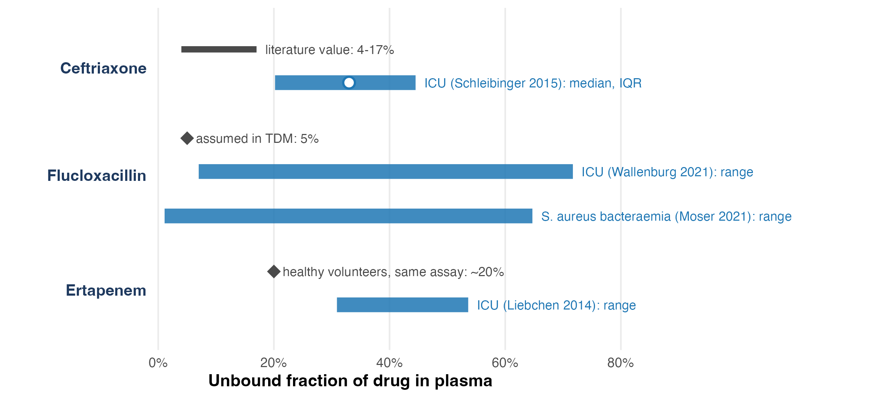
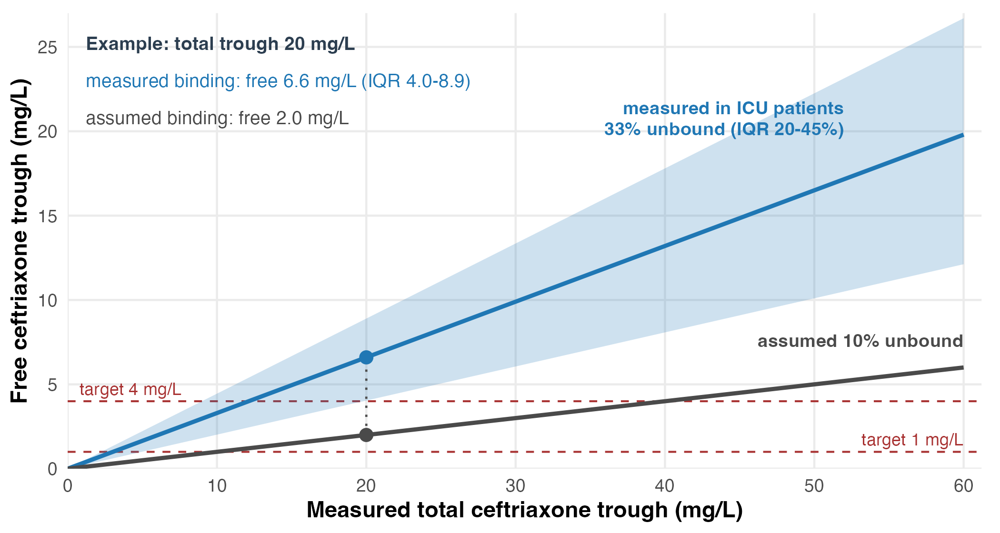
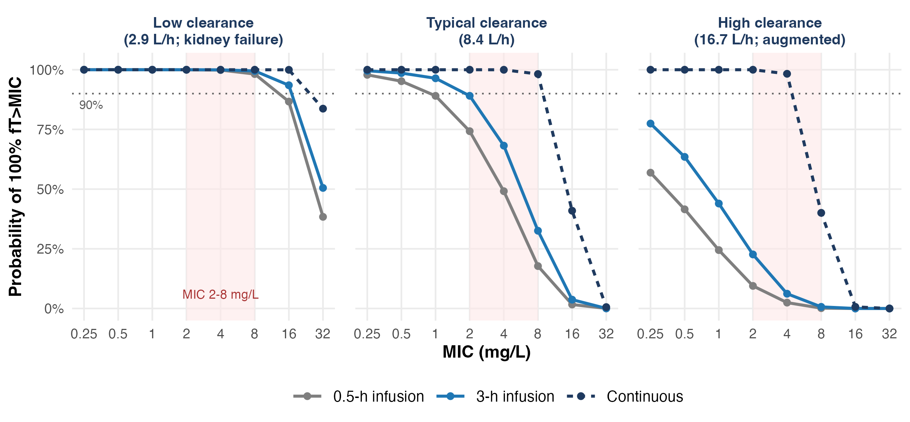
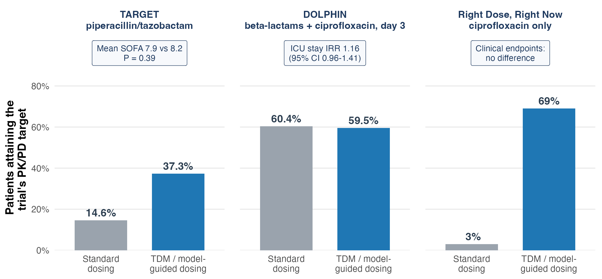

<!-- PROPOSED RUNNING ORDER (v2 skeleton). 14 content slides, about 25 min.
     Four figures are final; the rest are "Figure to draw" boxes with the exact published numbers to plot.
     20-minute version: drop the RRT slide, the cirrhosis-GFR slide and the total-to-free slide. -->

## More than half of the acute kidney injury present when infection is diagnosed resolves within 48 hours

::: {.todo-fig}
**Figure to draw.** Kidney-function trajectory or 100-patient icon array: of patients with AKI on admission, 57.2% resolved by 48 h. Add the admission-AKI rate by infection type (pneumonia 27.1%, intra-abdominal 19.5%, urinary 20.0%, skin 9.7%). Redraw from Crass 2019, Table 2 / Figure 2.
:::

::: {.source}
Admission AKI and 48-h resolution: [@crass2019]. AKI in 57.3% of ICU patients: [@hoste2015]
:::

::: notes
Hook. Dose-adjustment tables come from stable chronic kidney disease; our patients have unstable kidney function. Crass 2019 abstract: AKI on admission in 27.1% (pneumonia), 19.5% (intra-abdominal), 20.0% (urinary), 9.7% (skin); resolved by 48 h in 57.2%. AKI-EPI: 1032 of 1802 ICU patients (57.3%, 95% CI 55.0-59.6) had AKI. In cirrhosis with septic shock, renal dysfunction was present in 71.5% vs 54.8% without cirrhosis (Galbois 2014).
:::

## Reducing β-lactam doses for kidney injury in the first 24–48 hours is associated with worse outcomes

::: {.todo-fig}
**Figure to draw.** Two paired comparisons. (a) Ceftolozane/tazobactam vs meropenem, cIAI, baseline CrCl 30-50 mL/min: response 48% vs 69% (MITT); 72.7% vs 71.4% in the microbiologically evaluable population. (b) Early vs late renal dose adjustment in septic AKI: hazard ratio for in-hospital death 0.59 (95% CI 0.36-0.97) favouring late adjustment, n = 224.
:::

::: {.source}
Registration-trial subgroup: [@kullar2017]. Label precautions and rationale: [@crass2019]. Cohort: [@aldardeer2024]. Scoping review: [@horstink2025]
:::

::: notes
Be explicit that this is association, not proof. Kullar 2017: only 36 of 806 cIAI patients had moderate renal impairment; the difference disappears in the microbiologically evaluable population (72.7% vs 71.4%), and indeterminate responses explain much of the gap. Aldardeer 2024: prospective observational, 84 early vs 140 late adjusters, HR 0.588 (0.355-0.974). Horstink 2025: 11 studies, 1,407 patients, high risk of bias; three studies linked delayed reduction to lower mortality, one linked early reduction to less neurotoxicity. Applies to wide-therapeutic-index drugs only.
:::

## Creatinine-based equations get the average right and the individual patient wrong in critical illness

::: {.todo-fig}
**Figure to draw.** Scatter or Bland-Altman redrawn from Baptista 2014 (measured 8-h CrCl vs Cockcroft-Gault): means 135.5 vs 135.7 mL/min/1.73 m2, correlation R = 0.2, precision +/-40.9%. Second panel or inset: cancer patients, cystatin C eGFR >30% lower than creatinine eGFR in 29%; vancomycin trough >30 mg/L in 24% vs 9%.
:::

::: {.source}
ICU agreement: [@baptista2014; @carlier2015]. Cystatin C and cefepime clearance: [@barreto2023]. Cancer cohort: [@hanna2023]
:::

::: notes
Replace the simulated Bland-Altman with real data. Baptista 2014: no difference in means (8-h CrCl 135.5 vs CG 135.7), but R = 0.2 and all equations underestimated when measured CrCl >120 and overestimated when <120. Carlier 2015 (inulin reference, n = 68): creatinine equations biased and imprecise; measured urinary CrCl overestimated GFR; cystatin C equations unbiased but still imprecise. Barreto 2023: eGFRcr-cysC was the best predictor of cefepime clearance (n = 120). Hanna 2023 (n = 1,869 cancer patients): eGFRcys >30% lower than eGFRcr in 29%; vancomycin >30 mg/L 24% vs 9%, adjusted OR 2.59 (1.08-7.03).
:::

## Four in ten ICU patients have augmented renal clearance, which predicts sub-MIC β-lactam troughs

::: {.todo-fig}
**Figure to draw.** Left: pooled ARC prevalence 39% across 70 studies (Hefny 2022). Right: proportion of troughs below MIC by measured CrCl stratum: 82% when CrCl >= 130 mL/min/1.73 m2 (Udy 2012; 52 paired troughs and CrCl measures overall, subgroup size not reported in the abstract).
:::

::: {.source}
Prevalence: [@hefny2022; @udy2014]. Exposure: [@udy2012; @abdulla2020; @wong2018]. Outcome with high-dose continuous infusion: [@carrie2018]
:::

::: notes
Udy 2012: trough >= MIC in only 58% overall; CrCl >= 130 associated with trough < MIC in 82% and < 4x MIC in 72%. Abdulla 2020 (EXPAT, n = 147): 63.3% attained 100% fT>MIC(ECOFF); eGFR >= 90 was a risk factor for non-attainment. Wong 2018: ARC raised the odds of missing 100% fT>MIC (OR 2.47). Carrie 2018: with high-dose continuous infusion the underdosing rate was 12%.
:::

## During renal replacement therapy, urine output and RRT intensity set the dose requirement

::: {.todo-fig}
**Figure to draw.** Redraw the meropenem or piperacillin dosing nomogram from Roberts 2025 (dose by urine output and RRT intensity), or the SMARRT trough distributions: troughs failed to reach the lower target in 4% (meropenem), 4% (piperacillin) and 55% (vancomycin), and failed to reach the higher target in 26%, 36% and 72%.
:::

::: {.source}
SMARRT observational data: [@roberts2021]. Dosing regimens: [@roberts2025; @ulldemolins2026]
:::

::: notes
SMARRT (381 patients, 29 ICUs, 14 countries): 4- to 8-fold variability in dose, RRT prescription and residual renal function; median estimated total renal clearance 50 mL/min (IQR 35-65). Roberts 2025 (300 patients, 22 ICUs, 12 countries): requirements depend on urine output and RRT intensity and duration; extended or continuous infusion reached targets with lower daily doses. Ulldemolins 2026 (vancomycin, 65 patients): body weight and RRT intensity and duration drive requirements.
:::

## In kidney failure, overexposure is measurable harm: cefepime neurotoxicity tracks the trough concentration

::: {.todo-fig}
**Figure to draw.** Dot/box plot redrawn from Boschung-Pasquier 2020: cefepime trough 6.3 mg/L (IQR 4.1-8.6) without vs 21.6 mg/L (IQR 17.0-28.6) with neurotoxicity; no events below 7.7 mg/L, always above 38.1 mg/L.
:::

::: {.source}
Thresholds: [@boschungpasquier2020; @imani2017]. Randomised comparison: [@qian2023]
:::

::: notes
Balance slide: the first 48 h argument is not a licence for sustained overexposure. Boschung-Pasquier 2020 (n = 319 with troughs): neurotoxicity in 23.2%; eGFR 35 vs 82 mL/min/1.73 m2 in those with vs without neurotoxicity. ACORN (n = 2,511): cefepime vs piperacillin-tazobactam, no difference in AKI or death (OR 0.95, 0.80-1.13); fewer days alive and free of delirium and coma with cefepime (OR 0.79, 0.65-0.95). Imani 2017 gives trough thresholds for piperacillin, meropenem and flucloxacillin.
:::

## Child-Pugh class does not predict caspofungin exposure in critically ill patients

::: {.todo-fig}
**Figure to draw.** Bar: Child-Pugh class of 46 ICU patients on caspofungin (A = 5, B = 40, C = 1). Beside it, correlation of Child-Pugh score with AUC (r = 0.03, P = 0.84) against albumin with AUC (r = 0.45, P = 0.005). Redraw the scatter from Kurland 2019 if permitted.
:::

::: {.source}
ICU cohort: [@kurland2019]. Simulated regimens: [@martial2016]
:::

::: notes
Kurland 2019: 40 of 46 ICU patients were Child-Pugh B, so the label would reduce the dose in most of them, yet the score did not correlate with AUC, clearance or volume; hypoalbuminaemia correlated with LOW AUC. Martial 2016 (n = 21, all Child-Pugh B through low albumin): the label 70/35 mg regimen gave the lowest exposure. Both groups advise against dose reduction in ICU patients without cirrhosis.
:::

## In cirrhosis, creatinine-based equations overestimate GFR by about 20 mL/min when true GFR is below 60

::: {.todo-fig}
**Figure to draw.** Forest-style bias plot from Singapura 2021 (25 studies, n = 4,565): overestimate at measured GFR < 60: all equations +21.7 (17.7-25.7); CKD-EPI cystatin C +10.3 (2.1-18.4); GRAIL +12.6 (7.2-18.0) mL/min/1.73 m2.
:::

::: {.source}
Meta-analysis: [@singapura2021]. Consensus definitions: [@nadim2024]
:::

::: notes
This is where renally cleared, narrow-index drugs (aminoglycosides, vancomycin) are overdosed. Singapura 2021: creatinine equations overestimate (SMD 0.51), cystatin C equations underestimate (SMD -0.3), combined equations least biased. Use HRS-AKI terminology from the 2024 ADQI-ICA consensus, which replaces the 2015 ICA criteria cited in the first draft.
:::

## Liver failure enlarges the distribution volume, so first-day β-lactam exposure falls short

::: {.todo-fig}
**Figure to draw.** Day-1 probability of target attainment for Pseudomonas (target 4 x ECOFF = 8 mg/L), ACLF vs no liver failure (Grensemann 2020): meropenem 1 g q8h short infusion 18% vs 48%; with a 2 g loading dose plus 1 g q8h prolonged infusion 94% vs 91%. By day 7 the short-infusion regimen reaches 80% vs 65%. Peripheral volume 38.6 vs 19.7 L.
:::

::: {.source}
ACLF on CVVHD: [@grensemann2020]. Decompensated cirrhosis: [@bastida2020]. Outcome cohort: [@bartoletti2019]
:::

::: notes
This slide carries the loading-dose message. Grensemann 2020: 19 patients on continuous haemodialysis, 8 with ACLF; Monte Carlo simulation from a small cohort, P = 0.05 for the volume difference. The loading dose closes the day-1 gap (94% vs 18%). Bastida 2020 (n = 54): ACLF affected V; creatinine clearance and MELD affected clearance. Bartoletti 2019 (n = 119, observational): continuous/extended infusion 30-day mortality 16% vs 36%; adjusted HR 0.41.
:::

## The unbound fraction is not a constant: in ICU patients it spans up to tenfold around the textbook value

{fig-alt="Measured unbound fraction ranges of ceftriaxone, flucloxacillin and ertapenem in ICU patients compared with reference values" height=470}

::: {.source}
Published summary statistics. Ceftriaxone: [@schleibinger2015; @wong2013]. Flucloxacillin: [@wallenburg2021; @moser2021]. Ertapenem: [@liebchen2014]
:::

::: notes
Bars mix IQR and range because that is what each paper reports. The assay matters as well: unbound fraction by ultrafiltration depends on pH and temperature (Kratzer 2014; Liebchen 2014), and Wong 2013 found that published binding values OVER-predicted unbound ceftriaxone and flucloxacillin in their cohort. Direction differs between cohorts and assays; unpredictability is the consistent finding.
:::

## For the same measured total concentration, a fixed unbound fraction can misclassify target attainment

{fig-alt="Free ceftriaxone trough implied by a measured total trough under an assumed 10% unbound fraction versus the fraction measured in ICU patients" height=470}

::: {.source}
Arithmetic on published values: [@schleibinger2015; @gijsen2021]. Bias in population target-attainment estimates: [@toutain2023]
:::

::: notes
The original angle of the talk. At a total trough of 20 mg/L the assumed 10% gives 2.0 mg/L free (below a 4 mg/L target); the ICU-measured fraction gives 6.6 mg/L (IQR 4.0-8.9). Toutain 2023 shows the population-level version: scaling total concentrations by a single fu biases PTA and underestimates the PK/PD cutoff, because total concentrations are more variable than free ones. Heffernan 2022: albumin <= 20 g/L lowered ceftriaxone PTA by up to 20%. Jager 2020: flucloxacillin binding is non-linear; dose on unbound concentrations.
:::

## Prolonged infusion after a loading dose lowers mortality, and the gain is largest when clearance is high

{fig-alt="Simulated probability of 100% fT>MIC for meropenem by infusion mode in low, typical and high clearance strata" height=430}

::: {.source}
Mechanistic simulation; structural model from [@bastida2020], variability assumed. Trials and guidelines: [@dulhunty2024; @monti2023; @abdulaziz2024; @hong2026; @prescott2026]
:::

::: notes
Say plainly which trials were neutral. MERCY (n = 607): RR 0.96 (0.81-1.13). BLING III (n = 7,031): 90-day mortality 24.9% vs 26.8%, OR 0.91 (0.81-1.01), P = 0.08; clinical cure 55.7% vs 50.0%. Meta-analysis of 18 RCTs (n = 9,108): RR 0.86 (95% CrI 0.72-0.98). 2026 focused update: 28 RCTs, RR 0.91 (0.85-0.97). Surviving Sepsis 2026: strong recommendation, moderate certainty, after a loading dose. Simulation at MIC 2 mg/L: short vs 3-h vs continuous infusion 74% / 89% / 100% at typical clearance, 9% / 23% / 100% at high clearance, all about 100% at low clearance.
:::

## In randomised trials, TDM-guided dosing has not improved outcomes and often did not improve target attainment

{fig-alt="Target attainment by arm in the TARGET, DOLPHIN and Right Dose Right Now randomised trials" height=470}

::: {.source}
Published trial percentages: [@hagel2022; @ewoldt2022; @roggeveen2022]. Meta-analysis: [@paimangalore2022]. Guideline: [@prescott2026]
:::

::: notes
The honest slide. Targets differ between trials; compare arms within a trial. In Right Dose, Right Now, attainment did not improve for vancomycin, meropenem or ceftriaxone. Surviving Sepsis 2026: TDM suggested case by case (conditional, very low certainty). Argument to make: the intervention has to change exposure early to be tested fairly; candidates are the patients on the previous slides (augmented clearance, RRT, highly bound drugs, toxicity risk).
:::

## In the first 48 hours dose for the infection; after 48 hours dose for the measured organ function

::: {.todo-fig}
**Figure to draw.** One timeline, 0 to 96 h. 0-48 h: full loading dose, unreduced wide-index β-lactam, prolonged infusion. At 48 h: re-measure (urinary CrCl or cystatin C; RRT settings and urine output), then adjust. Throughout: measure rather than assume for narrow-index, highly bound, or toxicity-prone drugs.
:::

::: {.source}
Author's synthesis of the preceding slides
:::

::: notes
Close on one image, not five bullets. State the exception clearly: aminoglycosides, vancomycin and other narrow-index drugs need individualised dosing from the first dose.
:::

## References {visibility="uncounted"}

::: {#refs style="font-size: 0.45em;"}
:::
