```{=html}
<!-- v2, restructured 16 Nov 2026 to the assertion-evidence form (Alley) in the house style of
     l02-spectrum-slides.qmd. Three sections, each opened by an image that appears on the mapping
     slide and again on the closing slide. Headlines are sentence assertions, left-aligned, <= 2 lines
     (deck-level override of the theme's centred 1.6em h2). Sources sit in ::: aside, as in l02.
     Figures: scripts 08-21 write figures/*.png; every plotted number is a published summary statistic
     except the labelled simulation inset on the prolonged-infusion slide (script 11/18).
     RRT nomogram now a main-deck slide in section 2. Section 3 has four slides (unbound range, total-to-free, outcome cohorts, albumin correction).
     Original contribution (section 3): the false precision of fixed protein binding and how it
     could alter breakpoints and target attainment in PK/PD analysis.
     All main-deck figures are drawn; only the cirrhosis-GFR backup slide still carries a "Figure to draw" box
     (needs the Singapura 2021 full text). -->
```

```{=html}
<style>
/* Assertion-evidence headline rules (Alley): sentence headline, left-justified, at most two lines. */
.reveal h2 {text-align: left; font-size: 1.2em; line-height: 1.2; margin-bottom: 0.45em;}
.reveal .slide aside, .reveal .slide div.aside {font-size: 0.5em; color: #7a7a7a;}
.reveal .slide aside a {color: #7a7a7a;}
.todo-fig {border: 2px dashed #9aa3ad; border-radius: 8px; padding: 1em 1.3em; margin: 1em auto; width: 85%;
           font-size: 0.7em; color: #4a4a4a; background: #fafbfc; text-align: left;}
.vignette {font-size: 0.62em; color: #222; background: #f7f1f1; border-left: 4px solid #b20e10;
           padding: 0.35em 0.8em; margin: 0.2em auto 0.4em auto; width: 94%; line-height: 1.25; text-align: left;}
.mapcap {font-size: 0.68em; color: #222; line-height: 1.25; text-align: left; margin-top: 0.3em;}
.mapcap b {color: #9B0014;}
.light-text, .light-text h2 {color: #fff;}
</style>
```

## Optimizing antimicrobial therapy in patients <br> with liver and kidney failure {.light-text background-color="#b20e10"}

<center>

**Russell E. Lewis, Pharm.D., FCCP** <br> Associate Professor of Infectious Diseases <br> Department of Molecular Medicine, University of Padua <br>

<br>

{fig-align="center" width="330"}

<br> russelledward.lewis\@unipd.it

</center>

::: notes
Scope, said aloud: this talk is about β-lactams and the drugs for which under-dosing is the main risk. Narrow-therapeutic-index drugs (aminoglycosides, vancomycin, polymyxins) are the exception, and they come at the end.
:::

## This talk makes three claims about dosing when the kidney or the liver fails

::::::::: columns
:::: {.column width="33%"}
{width="100%"}

::: mapcap
**1 · Dose for the infection first.** Kidney injury present at diagnosis is usually transient; dose reductions in the first 48 h cost cures.
:::
::::

:::: {.column width="33%"}
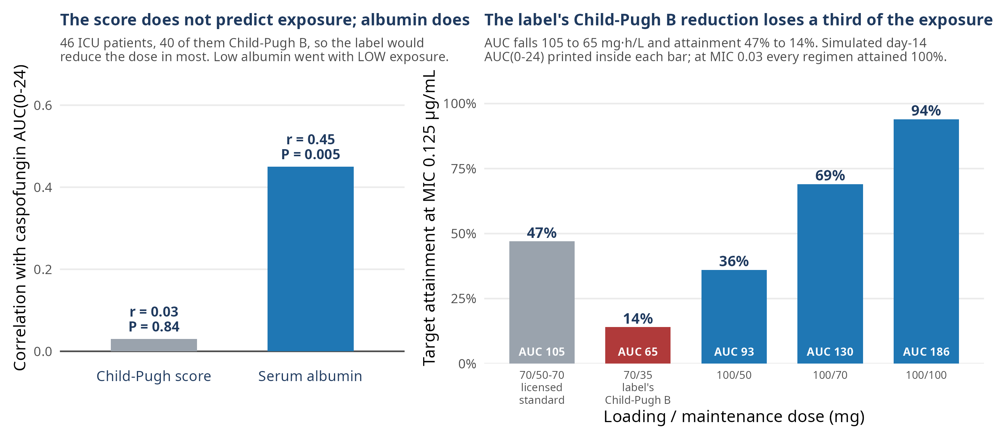{width="100%"}

::: mapcap
**2 · Measure, do not estimate.** Creatinine equations, Child-Pugh class and label tables estimate exposure badly in the ICU.
:::
::::

:::: {.column width="33%"}
{width="100%"}

::: mapcap
**3 · Binding is not a constant.** The unbound fraction cannot be assumed or calculated; it has to be measured or modelled.
:::
::::
:::::::::

::: notes
Mapping slide. The same three images return at the end. Each section opens with the image shown here.
:::

# 1 · Dose for the infection first {background-color="#b20e10"}

## More than half of the acute kidney injury present when infection is diagnosed resolves within 48 hours

::: vignette
**Hypothetical patient.** 58-year-old, alcohol-related cirrhosis (Child-Pugh B, albumin 22 g/L), septic shock from secondary peritonitis. Creatinine 2.1 mg/dL (baseline 0.8), no urine for 6 h. Meropenem is ordered; the renal-dosing table proposes 1 g q12h.
:::

{fig-align="center" width="900"}

::: aside
Admission AKI and 48-h resolution: [@crass2019]. AKI in 57.3% of ICU patients: [@hoste2015]
:::

::: notes
Hook. Dose-adjustment tables come from stable chronic kidney disease; our patients have unstable kidney function. Crass 2019 abstract: AKI on admission in 27.1% (pneumonia), 19.5% (intra-abdominal), 20.0% (urinary), 9.7% (skin); resolved by 48 h in 57.2%. AKI-EPI: 1032 of 1802 ICU patients (57.3%, 95% CI 55.0-59.6) had AKI. In cirrhosis with septic shock, renal dysfunction was present in 71.5% vs 54.8% without cirrhosis (Galbois 2014). Introduce the patient: we come back to her at 48 h.
:::

## Reducing β-lactam doses for kidney injury in the first 24–48 hours is associated with worse outcomes

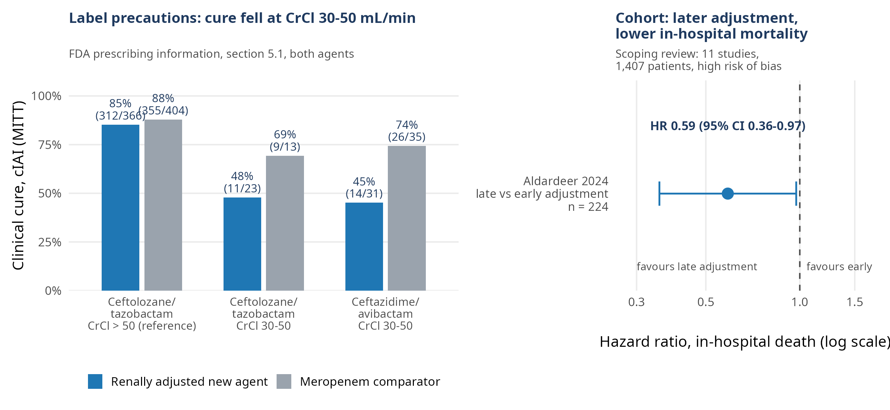{fig-align="center" width="950"}

::: aside
Label precautions (section 5.1): [@fda_zerbaxa2022; @fda_avycaz2025]; rationale: [@crass2019; @kullar2017]. Scoping review: [@horstink2025]. Cohort: [@aldardeer2024]
:::

::: notes
Association, not proof. Both FDA labels carry a precaution that cIAI cure was lower at CrCl 30-50 mL/min: ceftolozane/tazobactam 47.8% (11/23) vs meropenem 69.2% (9/13), against 85.2% vs 87.9% above 50; ceftazidime/avibactam 45% (14/31) vs 74% (26/35). The ceftazidime/avibactam label adds that these patients received a 33% lower daily dose than is now recommended: the renal adjustment itself was revised upward. Caveats: small subgroups (36 and 66 patients); Kullar 2017 showed the ceftolozane difference disappears in the microbiologically evaluable population (72.7% vs 71.4%). Horstink 2025: 11 studies, 1,407 patients, high risk of bias. Aldardeer 2024: prospective observational, 84 early vs 140 late adjusters, HR 0.588 (0.355-0.974). Wide-therapeutic-index drugs only.
:::

## Prolonged infusion after a loading dose lowers mortality in pooled trials; the two largest single trials were neutral

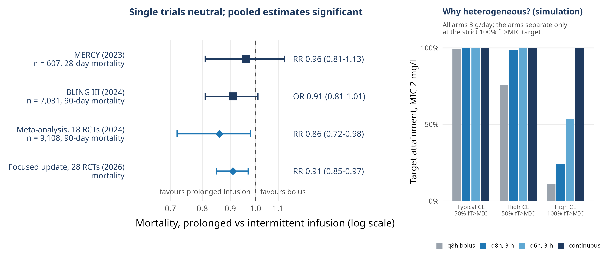{fig-align="center" width="950"}

::: aside
Trials and syntheses: [@monti2023; @dulhunty2024; @abdulaziz2024; @hong2026]. Guideline: [@prescott2026]. Inset: mechanistic simulation, structural model [@bastida2020], variability assumed
:::

::: notes
How to dose in the first 48 h: a full loading dose, then prolonged infusion. MERCY (n = 607): RR 0.96 (0.81-1.13). BLING III (n = 7,031): 90-day mortality 24.9% vs 26.8%, OR 0.91 (0.81-1.01), P = 0.08; clinical cure 55.7% vs 50.0%. Meta-analysis of 18 RCTs (n = 9,108): RR 0.86 (95% CrI 0.72-0.98). 2026 focused update: 28 RCTs, RR 0.91 (0.85-0.97). Surviving Sepsis 2026: strong recommendation, moderate certainty, prolonged infusion for maintenance after a loading dose. Note the mixed effect measures (OR for BLING III). The inset is OUR simulation, not data: at MIC 2 mg/L, short vs 3-h vs continuous infusion reach 100% fT\>MIC in 74% / 89% / 100% of simulated patients at typical clearance and 9% / 23% / 100% at high clearance. It explains why a pooled effect can coexist with neutral trials in mixed populations.
:::

## In kidney failure, overexposure is measurable harm: <br> cefepime neurotoxicity tracks the trough concentration

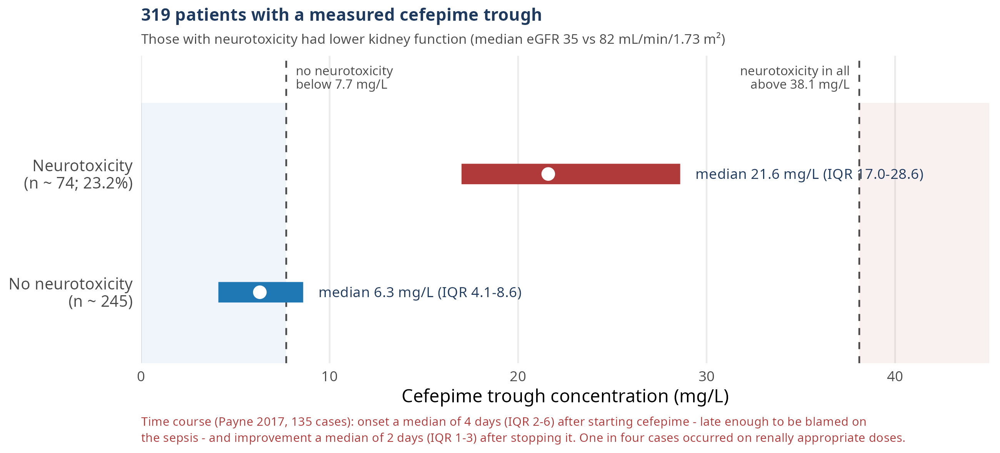{fig-align="center" width="950"}

::: aside
Thresholds: [@boschungpasquier2020; @imani2017]. Randomised comparison: [@qian2023]
:::

::: notes
The counterweight: the first-48-h argument is not a licence for sustained overexposure. Medians and IQRs as reported; patient-level data are not public, so no points are drawn. Boschung-Pasquier 2020 (n = 319 with troughs): neurotoxicity in 23.2%; eGFR 35 vs 82 mL/min/1.73 m² in those with vs without neurotoxicity; 6.3 (4.1-8.6) vs 21.6 (17.0-28.6) mg/L; none below 7.7, all above 38.1. ACORN (n = 2,511): cefepime vs piperacillin-tazobactam, no difference in AKI or death (OR 0.95, 0.80-1.13); fewer days alive and free of delirium and coma with cefepime (OR 0.79, 0.65-0.95). Deliberately cefepime-only; vancomycin and aminoglycoside toxicity belong to the narrow-index exception at the end.
:::

# 2 · Measure, do not estimate {background-color="#b20e10"}

<br> <br>

## Child-Pugh class does not predict caspofungin exposure in critically ill patients

{fig-align="center" width="950"}

::: aside
ICU cohort: [@kurland2019]. Simulated regimens: [@martial2016]
:::

::: notes
Section image. Kurland 2019: 40 of 46 ICU patients were Child-Pugh B, so the label would reduce the dose in most of them, yet the score did not correlate with AUC, clearance or volume (r = 0.03, P = 0.84); hypoalbuminaemia correlated with LOW AUC (r = 0.45, P = 0.005). Martial 2016 (n = 21, all Child-Pugh B through low albumin): the label 70/35 mg regimen gave the lowest exposure. Both groups advise against dose reduction in ICU patients without cirrhosis.
:::

## Few antimicrobials carry a hepatic dose adjustment; <br> for β-lactams, kidney function and albumin matter more

{fig-align="center" width="980"}

::: aside
Reviews: [@halilovic2014; @verbeeck2008]. Systematic review in cirrhosis: [@comce2024]. Label cells: current US prescribing information of each drug (verify before presenting)
:::

::: notes
Halilovic & Heintz 2014 reviewed 22 antibiotics with hepatic or mixed renal-hepatobiliary clearance and found the data sparse; many studies predate routine Child-Pugh classification. Verbeeck 2008: no endogenous marker of hepatic clearance exists; Child-Pugh was built to predict surgical mortality, not drug exposure. Comce 2024 (ceftriaxone, gentamicin, meropenem, vancomycin): alterations in AUC and clearance were found, but the evidence does not support specific dosing recommendations. The point of the table is how short the blue column is. CHECK each label cell against the current PI/SmPC before presenting.
:::

## Liver failure enlarges the distribution volume, <br> so first-day β-lactam exposure falls short

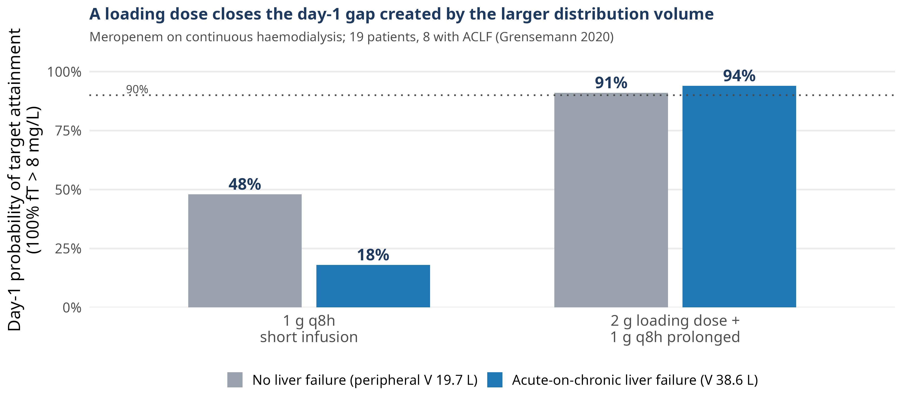{fig-align="center" width="950"}

::: aside
ACLF on CVVHD: [@grensemann2020]. Decompensated cirrhosis: [@bastida2020]. Outcome cohort: [@bartoletti2019]
:::

::: notes
This slide carries the loading-dose message. Grensemann 2020: 19 patients on continuous haemodialysis, 8 with ACLF; peripheral volume 38.6 vs 19.7 L (P = 0.05); Monte Carlo simulation from a small cohort. Day-1 PTA for 100% fT \> 8 mg/L: 18% vs 48% with 1 g q8h short infusion; 94% vs 91% with a 2 g loading dose plus 1 g q8h prolonged infusion. Bastida 2020 (n = 54): ACLF affected V; creatinine clearance and MELD affected clearance. Bartoletti 2019 (n = 119, observational): continuous/extended infusion 30-day mortality 16% vs 36%; adjusted HR 0.41. Our patient: Child-Pugh B with ascites and low albumin, so a full loading dose regardless of the creatinine.
:::

## During renal replacement therapy, urine output and RRT intensity set the dose — and most patients receive more

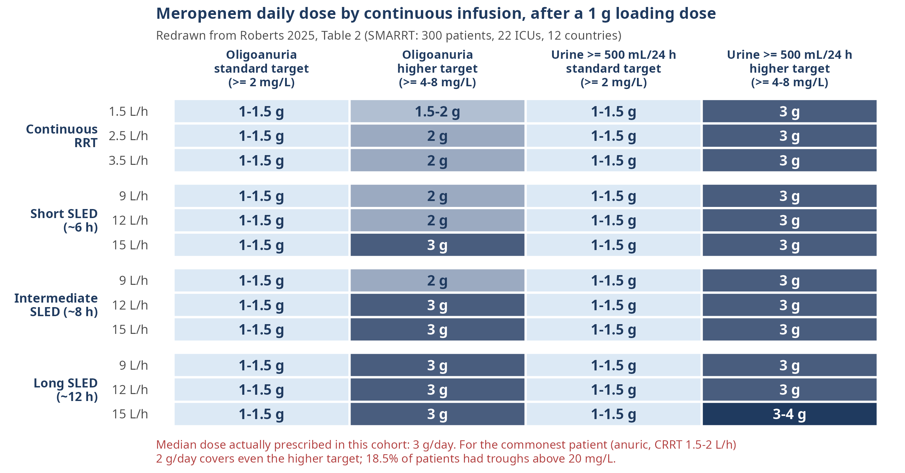{fig-align="center" height="560"}

::: aside
Redrawn from [@roberts2025], Table 2 (open access, CC BY): doses transcribed, merged cells expanded to the intensities they cover. Observational PK data: [@roberts2021]. Vancomycin equivalent: [@ulldemolins2026]
:::

::: notes
SMARRT, 300 patients, 22 ICUs, 12 countries; population PK models externally validated (mean prediction error -5.2% for meropenem), then Monte Carlo simulation. Read the grid: only two variables move the dose - urine output and RRT intensity - and only when you aim at the higher target. For the standard target (unbound steady state >= 2 mg/L, i.e. 100% fT>MIC and 4xMIC for Enterobacterales) the answer is 1-1.5 g/day by continuous infusion in EVERY cell. The higher target (>= 4-8 mg/L, empirical or 4xMIC for Pseudomonas) needs 2 g if anuric on CRRT, 3 g once urine output reaches 500 mL/24 h or SLED is long and intense, up to 3-4 g. All after a 1 g loading dose over 30 min; all as continuous infusion, which in every simulated scenario reached target with a LOWER daily dose than short infusion. The message for an ICU audience is the red line: the median dose actually prescribed in this cohort was 3 g/day, 18.5% had troughs above 20 mg/L and 1.5% above the 45 mg/L toxicity threshold, while only 1.3% were below the breakpoint. On RRT the risk has inverted - these patients are over-exposed, not under-exposed. Caveats: observational PK, no clinical outcomes, and the authors note the toxicity thresholds come from retrospective data. The piperacillin/tazobactam nomogram is Table 3 of the same paper (6/0.75 g-8/1 g per day CI standard; up to 16/2 g for the higher target). Earlier SMARRT report (Roberts 2021) gives the trough distributions: failure to reach the lower target in 4% meropenem, 4% piperacillin, 55% vancomycin; the higher target in 26%, 36% and 72%.
:::

## Creatinine-based equations get the average right and the individual patient wrong in critical illness

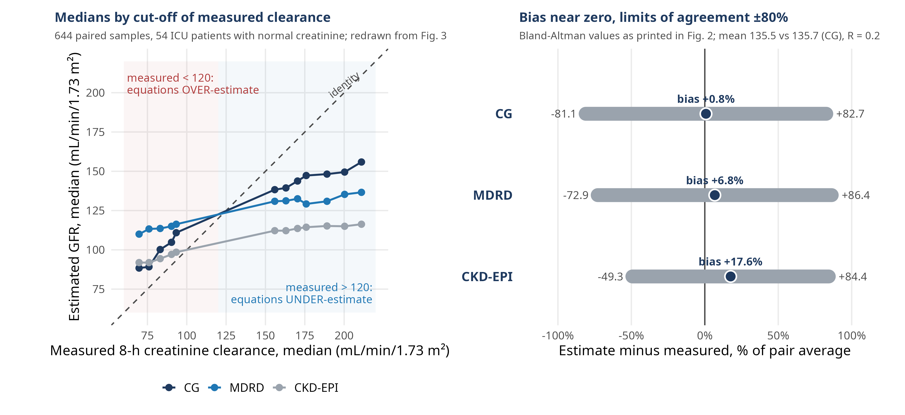{fig-align="center" width="980"}

::: aside
Redrawn from [@baptista2014]: Fig. 3 medians digitised from the published chart (about 0.3 mL/min resolution), Fig. 2 values as printed. Inulin reference: [@carlier2015]. Cystatin C: [@barreto2023; @hanna2023]
:::

::: notes
Baptista 2014 (54 ICU patients with normal creatinine, 644 paired 8-h urinary clearances; 12 nested cut-off subgroups): no difference in means (8-h CrCl 135.5 vs CG 135.7), but R = 0.2 and all equations underestimated when measured CrCl \>120 and overestimated when \<120. Carlier 2015 (inulin reference, n = 68): creatinine equations biased and imprecise; measured urinary CrCl overestimated GFR; cystatin C equations unbiased but still imprecise. Barreto 2023: eGFRcr-cysC was the best predictor of cefepime clearance (n = 120). Hanna 2023 (n = 1,869 cancer patients): eGFRcys \>30% lower than eGFRcr in 29%; vancomycin \>30 mg/L 24% vs 9%, adjusted OR 2.59 (1.08-7.03). Present measured CrCl and cystatin C as better, not as the answer.
:::

## Four in ten ICU patients have augmented renal clearance, which predicts sub-MIC β-lactam troughs

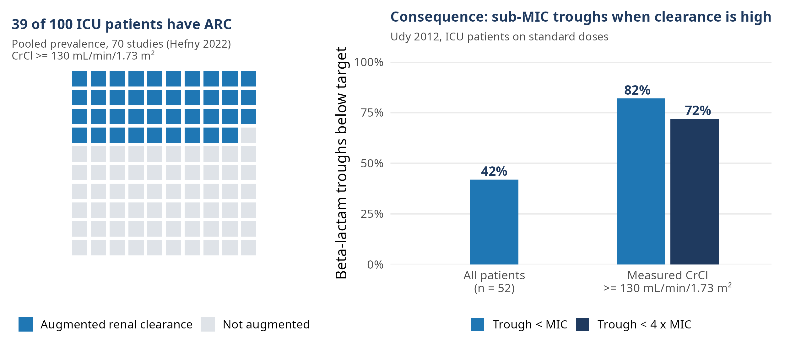{fig-align="center" width="950"}

::: aside
Prevalence: [@hefny2022; @udy2014]. Exposure: [@udy2012; @abdulla2020; @wong2018]. Outcome with high-dose continuous infusion: [@carrie2018]
:::

::: notes
Udy 2012 (n = 52): trough \>= MIC in only 58% overall; CrCl \>= 130 associated with trough \< MIC in 82% and \< 4x MIC in 72% (subgroup size not in the abstract). Abdulla 2020 (EXPAT, n = 147): 63.3% attained 100% fT\>MIC(ECOFF); eGFR \>= 90 was a risk factor for non-attainment. Wong 2018: ARC raised the odds of missing 100% fT\>MIC (OR 2.47). Carrie 2018: with high-dose continuous infusion the underdosing rate was 12%.
:::

## TDM-guided dosing raised target attainment in two of three randomised trials but did not improve clinical outcomes

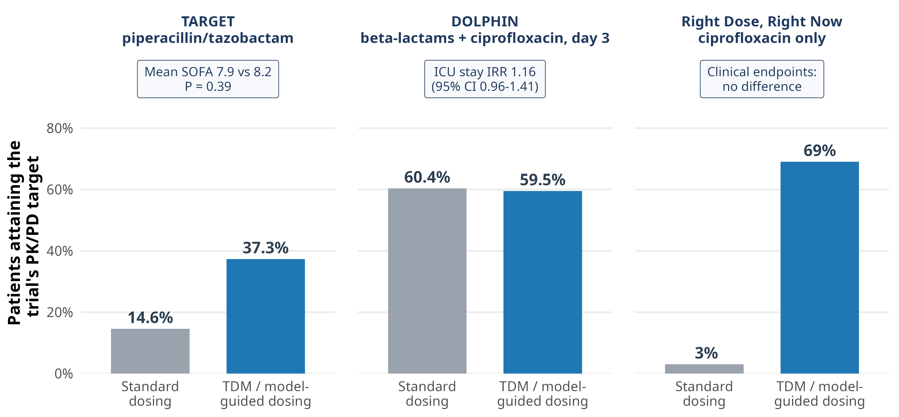{fig-align="center" width="950"}

::: aside
Published trial percentages: [@hagel2022; @ewoldt2022; @roggeveen2022]. Meta-analysis: [@paimangalore2022]. Guideline: [@prescott2026]
:::

::: notes
Measuring is necessary but, so far, not sufficient. Targets differ between trials; compare arms within a trial. TARGET: 14.6% to 37.3%, SOFA unchanged. Right Dose, Right Now: ciprofloxacin 3% to 69%; attainment did not improve for vancomycin, meropenem or ceftriaxone; clinical endpoints unchanged. DOLPHIN: 59.5% vs 60.4% at day 3; ICU stay IRR 1.16 (0.96-1.41). Surviving Sepsis 2026: TDM suggested case by case (conditional, very low certainty). Exposure changed but outcome did not, so either the targets, the timing (day 3 is late) or the populations were wrong. Candidates for benefit: augmented clearance, RRT, highly bound drugs, toxicity risk. And one more reason, which is section 3: most of these trials measured TOTAL concentrations.
:::

# 3 · Protein binding is not a constant {background-color="#b20e10"}

## The unbound fraction is not a constant: in ICU patients it spans up to tenfold around the textbook value

{fig-align="center" width="950"}

::: aside
Published summary statistics. Ceftriaxone: [@schleibinger2015; @wong2013]. Flucloxacillin: [@wallenburg2021; @moser2021]. Ertapenem: [@liebchen2014]
:::

::: notes
Section image. Bars mix IQR and range because that is what each paper reports. The assay matters as well: unbound fraction by ultrafiltration depends on pH and temperature (Kratzer 2014; Liebchen 2014), and Wong 2013 found that published binding values OVER-predicted unbound ceftriaxone and flucloxacillin in their cohort. Direction differs between cohorts and assays; unpredictability is the consistent finding.
:::

## For the same measured total concentration, a fixed unbound fraction can misclassify target attainment

{fig-align="center" width="900"}

::: aside
Arithmetic on published values: [@schleibinger2015; @gijsen2021]. Bias in population target-attainment estimates: [@toutain2023]. Band assumes concentration-independent binding; ceftriaxone binding is saturable [@heffernan2022]
:::

::: notes
The original angle of the talk. At a total trough of 20 mg/L the assumed 10% gives 2.0 mg/L free (below a 4 mg/L target); the ICU-measured fraction gives 6.6 mg/L (IQR 4.0-8.9). Toutain 2023: scaling total concentrations by a single fu biases PTA and underestimates the PK/PD cutoff, because total concentrations are more variable than free ones. Heffernan 2022: albumin \<= 20 g/L lowered ceftriaxone PTA by up to 20%; binding is saturable, so the band understates the spread at high totals. Jager 2020: flucloxacillin binding is non-linear; dose on unbound concentrations.
:::

## Cohorts link hypoalbuminaemia to failure of ertapenem and ceftriaxone; only one had a low-binding comparator

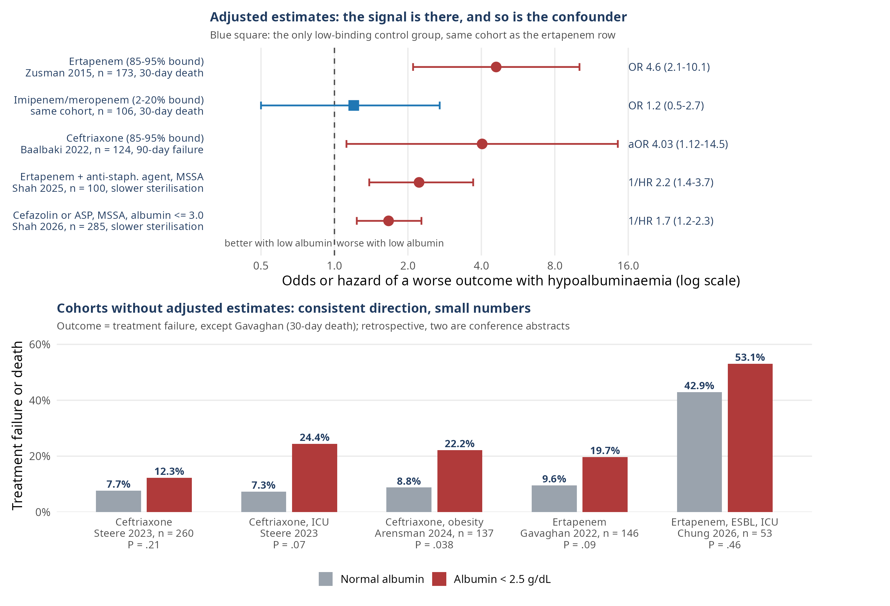{fig-align="center" height="560"}

::: aside
Adjusted estimates: [@zusman2015; @baalbaki2022; @shah2025; @shah2026]. Crude cohorts: [@steere2023; @arensman2024; @gavaghan2022; @chung2026]; drug comparison [@vandorf2024]. Review: [@acbo2025]. Guidance: [@idsa2024]
:::

::: notes
Answer to the question "is there outcome evidence?": yes, consistently in one direction, and almost all of it confounded. Albumin is one of the strongest prognostic markers in hospital medicine, so every cohort compares sick with sicker. Zusman 2015 is the exception that proves the point: prospective, 279 patients, the association between hypoalbuminaemia and 30-day death was OR 4.6 (2.1-10.1) with ertapenem and 1.2 (0.5-2.7) with imipenem or meropenem in the same cohort (P = 0.02 for the interaction). That design has not been repeated. Against it: Shah 2026 finds the same slower sterilisation with cefazolin, which is less bound and given q8h; Moser 2021 (measured unbound flucloxacillin) found the deaths among patients with HIGH free concentrations (14.8 vs 1.7 mg/L). The pharmacology (Benet and Hoener 2002; Gandia 2023) predicts exactly this: average unbound exposure is preserved when albumin falls; what changes is the trough, which matters for once-daily time-dependent drugs - ertapenem 1 g and ceftriaxone 1 g - and far less for q6h or continuous dosing. Ackerman 2020: 2 g ceftriaxone removed the excess failure in the hypoalbuminaemic subgroup (30.4% vs 9.7%). IDSA 2024 prefers meropenem over ertapenem in hypoalbuminaemic critically ill patients on this evidence. No outcome study measured unbound drug; that is the study still to be done. Full table: hypoalbuminaemia_outcomes_evidence_table.md in the repo.
:::

## An albumin correction of the phenytoin type fails for β-lactams, and performs poorly even for phenytoin in the ICU

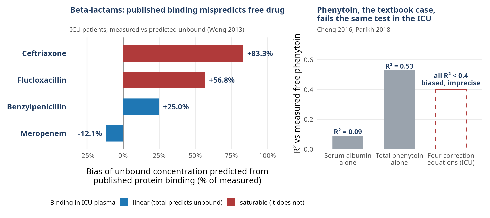{fig-align="center" width="950"}

::: aside
β-lactams: [@wong2013]; a population-specific saturable-binding model does predict free ceftriaxone: [@gijsen2021]. Phenytoin: [@kiang2016; @cheng2016; @parikh2018]; mechanistic non-linear model: [@terheine2019]
:::

::: notes
The question every pharmacist asks: why not a Sheiner-Tozer correction, as taught for phenytoin? Three answers. (1) The equation assumes linear binding to one site with albumin as the only variable. Wong 2013 (ICU, 7 β-lactams): unbound concentrations predicted from published binding were biased by +83.3% for ceftriaxone, +56.8% for flucloxacillin, +25% for benzylpenicillin and -12.1% for meropenem; total and unbound were linearly related for every drug EXCEPT ceftriaxone and flucloxacillin, whose binding is saturable. (2) Even the textbook case fails in our patients: Cheng 2016 found albumin explained 9% and total phenytoin 53% of the variance in free phenytoin, and all equations performed poorly in critical care; Parikh 2018 tested four equations in a medical ICU, R² \< 0.4 for all, biased and imprecise. ter Heine 2019 showed phenytoin binding itself is concentration-dependent; a mechanistic non-linear model beat Winter-Tozer in 4 of 5 external datasets. (3) What does work is a binding model built in the right population with albumin AND concentration as covariates (Gijsen 2021 for ceftriaxone) - that is model-informed dosing, not a bedside formula. Practical message: for highly bound drugs in hypoalbuminaemic ICU patients, measure the unbound concentration or use a validated saturable-binding model; do not divide by a textbook fraction and do not apply a Sheiner-Tozer-style correction. Antifungals: voriconazole (\~58% bound) and posaconazole (\~98%) have the same problem and even fewer data.
:::

## In the first 48 hours dose for the infection; after 48 hours dose for the measured organ function

{fig-align="center" width="980"}

::: vignette
**The same patient at 48 h:** creatinine 1.2 mg/dL, urine output 90 mL/h — the AKI resolved; the q12h table dose would have under-dosed her for two days. **At 72 h:** creatinine rising again, CRRT started — measure (urine output, effluent dose, hours on the filter) and re-dose.
:::

::: notes
State the exception from the slide: aminoglycosides, vancomycin, polymyxins and the highly bound β-lactams are individualised from the first dose. Return to the patient: at 48 h her kidney function had recovered, at 72 h it had failed again; both changes are invisible to a dose chosen from the admission creatinine.
:::

## Three claims to take home

::::::::: columns
:::: {.column width="33%"}
{width="100%"}

::: mapcap
**1 · Dose for the infection first.** Full loading dose, unreduced wide-index β-lactam, prolonged infusion; re-measure at 48 h.
:::
::::

:::: {.column width="33%"}
{width="100%"}

::: mapcap
**2 · Measure, do not estimate.** Urinary CrCl or cystatin C, urine output and RRT dose; not Cockcroft-Gault, Child-Pugh or the label table.
:::
::::

:::: {.column width="33%"}
{width="100%"}

::: mapcap
**3 · Binding is not a constant.** For highly bound drugs, measure unbound drug or use a saturable-binding model; no fixed fraction, no albumin formula.
:::
::::
:::::::::

::: notes
Closing slide repeats the mapping images (assertion-evidence convention). Thank you; questions.
:::

## Backup: In cirrhosis, creatinine-based equations overestimate GFR by about 20 mL/min when true GFR is below 60 {visibility="uncounted"}

::: todo-fig
**Figure to draw.** Forest-style bias plot from Singapura 2021 (25 studies, n = 4,565): overestimate at measured GFR \< 60: all equations +21.7 (17.7-25.7); CKD-EPI cystatin C +10.3 (2.1-18.4); GRAIL +12.6 (7.2-18.0) mL/min/1.73 m².
:::

::: aside
Meta-analysis: [@singapura2021]. Consensus definitions: [@nadim2024]
:::

::: notes
This is where renally cleared, narrow-index drugs (aminoglycosides, vancomycin) are overdosed. Singapura 2021: creatinine equations overestimate (SMD 0.51), cystatin C equations underestimate (SMD -0.3), combined equations least biased. Use HRS-AKI terminology from the 2024 ADQI-ICA consensus.
:::

## References {.smaller visibility="uncounted"}

::: {#refs}
:::
