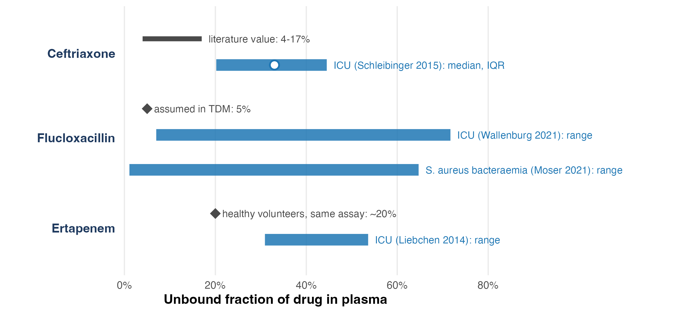
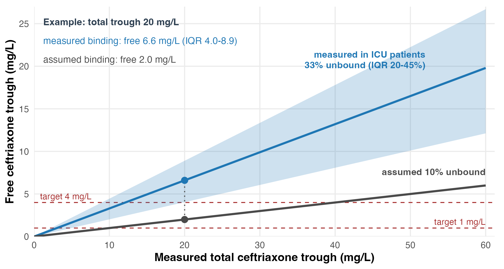
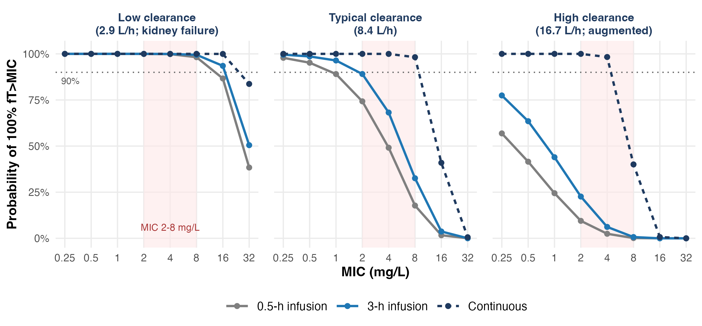
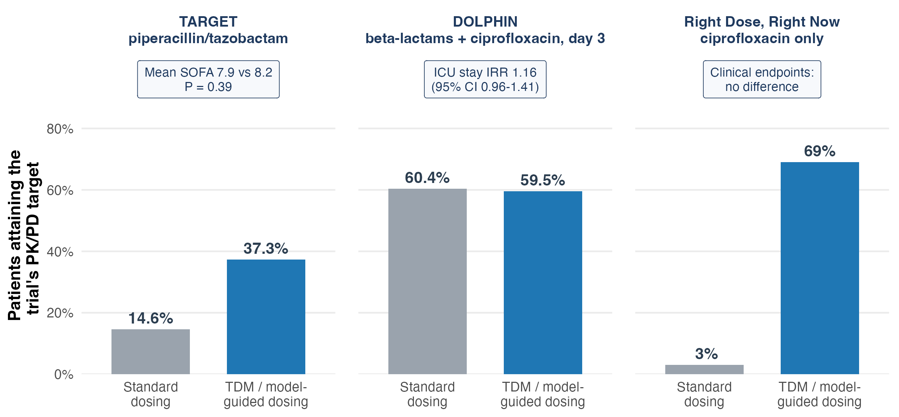

# Feedback on "Optimizing antimicrobial therapy in patients with liver and kidney failure"

Draft reviewed: `pkpd_organ_failure.qmd`, `refs.bib`, the seven R figure scripts and `interesting_idea_for talk.txt` in `/Users/russelllewis/Desktop/kidney_liver` (the files named below were added to that folder on request; no existing file was modified). Literature checked on 10 November 2026.

## Verdict

The headlines are already sentence assertions and the styling follows the assertion-evidence form. The evidence does not yet match: 10 of the 18 content slides hold placeholder figures, and 3 of the 7 rendered figures (prevalence, dosing-table scatter, Bland-Altman) are simulations with invented parameters standing in for empirical claims. The reference list (24 entries, median year 2013.5, 5 from 2020 onward) misses the trials and guidelines that changed this field between 2022 and 2026. At 18 content slides plus 6 section dividers, the deck will run past 30 minutes at the usual 1.5-2 minutes per assertion-evidence slide.

## Six changes that matter most

1. **Cut to 14 content slides (about 25 min).** Drop the six section dividers, the PK/PD-indices slide, the half-life-vs-CrCl slide, the cirrhosis 2x2 schematic and the duplicated take-home. The running order below gives timings and a 20-minute variant.
2. **Replace simulated "data" with redrawn published data.** A simulation is legitimate evidence for a pharmacokinetic mechanism (your PTA slide). It is not evidence for prevalence, agreement between GFR methods, or dosing-table failure. Each of those slides now has a named primary source and the exact numbers to plot.
3. **Open with transient kidney injury, not prevalence.** In Crass 2019, 57.2% of admission AKI had resolved by 48 h, and three registration programmes carry label precautions for lower response at CrCl 30-50 mL/min. This reframes "dose adjustment" as a timing problem and gives the talk a through-line that ends in a single take-home.
4. **Tell the trial evidence as it is.** Prolonged infusion is now a strong recommendation (Surviving Sepsis 2026), driven by the 2024 meta-analysis rather than by BLING III or MERCY alone. TDM/MIPD has three neutral randomised trials and a conditional, very-low-certainty recommendation. The current closing line ("TDM + Bayesian MIPD is the operational answer to all of the above") is not supported; a talk that says so plainly will be more credible to an informed audience.
5. **Make your protein-binding idea the original contribution.** It has direct primary support (Toutain 2023 on biased PTA; measured unbound fractions in ICU patients). Two finished figures are supplied.
6. **Add one toxicity slide.** A kidney-failure talk that only discusses underexposure is half the picture. Cefepime neurotoxicity thresholds and ACORN give real data.

## Proposed running order

| # | min | Assertion headline | Evidence to show | Primary sources (bib keys) |
|---|---|---|---|---|
| 1 | 1.5 | More than half of the acute kidney injury present when infection is diagnosed resolves within 48 hours | Icon array or trajectory: 57.2% resolved by 48 h; admission AKI 27.1% pneumonia, 19.5% intra-abdominal, 20.0% urinary, 9.7% skin | crass2019; hoste2015 |
| 2 | 2 | Reducing β-lactam doses for kidney injury in the first 24-48 hours is associated with worse outcomes | cIAI, CrCl 30-50: response 48% vs 69% (ceftolozane/tazobactam vs meropenem, MITT); late vs early adjustment HR 0.59 (0.36-0.97) | kullar2017; aldardeer2024; horstink2025 |
| 3 | 2 | Creatinine-based equations get the average right and the individual patient wrong in critical illness | Measured 8-h CrCl vs Cockcroft-Gault: means 135.5 vs 135.7, R = 0.2; cystatin C discordance 29%, vancomycin >30 mg/L 24% vs 9% | baptista2014; carlier2015; barreto2023; hanna2023 |
| 4 | 1.5 | Four in ten ICU patients have augmented renal clearance, which predicts sub-MIC β-lactam troughs | Pooled prevalence 39% (70 studies); trough < MIC in 82% when CrCl ≥130 | hefny2022; udy2012; abdulla2020 |
| 5 | 2 | During renal replacement therapy, urine output and RRT intensity set the dose requirement | SMARRT trough distributions or the 2025 dosing nomogram | roberts2021; roberts2025; ulldemolins2026 |
| 6 | 1.5 | In kidney failure, overexposure is measurable harm: cefepime neurotoxicity tracks the trough concentration | Trough 6.3 vs 21.6 mg/L without vs with neurotoxicity; none below 7.7, always above 38.1 mg/L | boschungpasquier2020; qian2023; imani2017 |
| 7 | 2 | Child-Pugh class does not predict caspofungin exposure in critically ill patients | 40 of 46 ICU patients Child-Pugh B; score vs AUC r = 0.03; albumin vs AUC r = 0.45 | kurland2019; martial2016 |
| 8 | 1.5 | In cirrhosis, creatinine-based equations overestimate GFR by about 20 mL/min when true GFR is below 60 | Bias by equation at GFR <60: all +21.7, CKD-EPI cystatin C +10.3, GRAIL +12.6 mL/min/1.73 m² | singapura2021; nadim2024 |
| 9 | 2 | Liver failure enlarges the distribution volume, so first-day β-lactam exposure falls short | Day-1 PTA, ACLF vs no liver failure: 18% vs 48% on 1 g q8h; 94% vs 91% with a 2 g loading dose | grensemann2020; bastida2020; bartoletti2019 |
| 10 | 2 | The unbound fraction is not a constant: in ICU patients it spans up to tenfold around the textbook value | **Figure supplied** | schleibinger2015; wallenburg2021; moser2021; liebchen2014; wong2013 |
| 11 | 2 | For the same measured total concentration, a fixed unbound fraction can misclassify target attainment | **Figure supplied** | toutain2023; gijsen2021; heffernan2022 |
| 12 | 2 | Prolonged infusion after a loading dose lowers mortality, and the gain is largest when clearance is high | **Figure supplied** (mechanistic simulation) plus trial numbers | abdulaziz2024; dulhunty2024; monti2023; hong2026; prescott2026 |
| 13 | 2 | In randomised trials, TDM-guided dosing has not improved outcomes and often did not improve target attainment | **Figure supplied** | hagel2022; ewoldt2022; roggeveen2022; prescott2026 |
| 14 | 1.5 | In the first 48 hours dose for the infection; after 48 hours dose for the measured organ function | One timeline (0-96 h) replacing the five-bullet take-home | synthesis |

Total 25.5 min plus the title. **20-minute variant:** drop slides 5, 8 and 11 (20 min). Slide 9 now carries the loading-dose message with real data, so the separate loading-dose slide is not needed.

The same order is written out as a Quarto skeleton, [pkpd_organ_failure_v2.qmd](pkpd_organ_failure_v2.qmd), with speaker notes that contain only numbers I read in the source abstracts. It renders ([pkpd_organ_failure_v2.html](pkpd_organ_failure_v2.html)) with all 44 citation keys resolved. Ten slides hold a "Figure to draw" box listing the numbers to plot.

## Corrections to specific claims in the current draft

| Draft slide | Problem | What the primary sources say | Suggested fix |
|---|---|---|---|
| Opening (prevalence) | Bars are simulated from invented proportions (0.50, 0.28, 0.18 ...); figure shows 50% while the takeaway says 57%; the oncology/HSCT bars have no source | AKI-EPI: 1032/1802 = 57.3% (95% CI 55.0-59.6) | Replace with new slide 1; say the 57% aloud |
| Dosing tables | Assertion is about label tables; evidence is simulated vancomycin; the cited study (DALI) measured β-lactams and did not test label tables | DALI: 16% of 248 missed 50% fT>MIC; OR 0.68 for positive outcome | Replace with new slide 2 |
| GFR estimates (Bland-Altman) | Bias and limits of agreement are properties of the simulation settings, not of patients | Baptista 2014: means equal (135.5 vs 135.7), R = 0.2, precision ±40.9%; equations underestimate above 120 and overestimate below | Redraw from Baptista 2014 |
| GFR estimates, notes | "Solution is urinary 8-h CrCl" | Carlier 2015 (inulin reference): measured urinary CrCl overestimated GFR; cystatin C equations unbiased but imprecise | Present measured CrCl and cystatin C as better, not as the answer |
| Augmented renal clearance | "Sub-therapeutic exposure in up to half" merges prevalence with underexposure | Prevalence 39% pooled; trough < MIC in 82% of those with CrCl ≥130 (n = 52) | New slide 4 wording |
| CRRT | In-vitro sieving coefficients; "Pea/Roberts equations" not identified | SMARRT 2021 and its 2025/2026 dosing papers supersede this | New slide 5 |
| Loading dose | "Delays target attainment by 1-3 half-lives" and the remark about pharmacy curricula have no source | Grensemann 2020; Surviving Sepsis 2026 and Hong 2026 specify a loading dose before prolonged infusion | Fold into new slides 9 and 12 |
| Child-Pugh | "Clearance spans 3-10× within class", "voriconazole spans an order of magnitude", "tigecycline AUC doubles" are unsourced; I could not verify them | Kurland 2019 and Martial 2016 give direct ICU data | New slide 7 |
| Hepatorenal syndrome | "Overestimates by a factor of two or more" unsourced; 2015 ICA criteria superseded | Singapura 2021: +21.7 mL/min/1.73 m² at GFR <60; ADQI-ICA 2024 consensus | New slide 8; use "HRS-AKI" |
| Free-drug and binding slides, notes | Binding quoted as constants (ceftriaxone 95%, ertapenem 95%, flucloxacillin 95%) | ICU unbound fraction: ceftriaxone median 33.0% (IQR 20.2-44.5); ertapenem 30.9-53.6%; flucloxacillin 7.0-71.7% | This is the "false precision"; new slide 10 |
| Total vs free TDM | Claims total looks in range while free is sub-target, citing flucloxacillin endocarditis without a source | Flucloxacillin: free fraction usually higher than the assumed 5% (Wallenburg, Moser), with excessive free concentrations in 33% of critically ill patients; Wong 2013 found the opposite direction of error | Assert "unpredictable", not "sub-target"; new slide 11 |
| Prolonged infusion | "In patients with altered Vd"; notes say BLING III and MERCY "support" | MERCY RR 0.96 (0.81-1.13); BLING III OR 0.91 (0.81-1.01), P = 0.08; meta-analysis RR 0.86 (95% CrI 0.72-0.98). Benefit depends on clearance, not volume | New slide 12 |
| MIPD | "Centers that have made this work ... show measurable improvement in target attainment" | DOLPHIN: attainment 59.5% vs 60.4% at day 3; ICU stay IRR 1.16 (0.96-1.41) | New slide 13 |
| qmd comment | "Abdul-Aziz ... BLING-III ... first author is Dulhunty" | Both exist: Dulhunty is the trial; Abdul-Aziz is the companion meta-analysis (JAMA 2024;332:638-648) | Cite both |
| Cirrhosis mechanisms, notes | "Tigecycline (metabolism)" | From my recollection of the label, tigecycline is eliminated mainly unchanged in bile; I did not verify this today | Check before use |

All 24 entries in your `refs.bib` match Crossref on title, first author, year, volume and first page.

## Supplied figures

**Slide 10.** Published summary statistics only; the bars mix IQR and range because that is what each paper reports.

**Slide 11.** Arithmetic on the ceftriaxone values above; targets of 1 and 4 mg/L are those used by Gijsen 2021. Binding is treated as concentration-independent within a patient, which understates the effect for a saturably bound drug.

**Slide 12.** Mechanistic simulation, not patient data. Structural model from Bastida 2020 (CL 8.35 L/h, V 28.2 L); the clearance strata (0.35×, 1×, 2×), the 30% between-patient variability and the unreduced 1 g q8h dose in every stratum are my assumptions. At MIC 2 mg/L, short vs 3-h vs continuous infusion reach 100% fT>MIC in 74% / 89% / 100% of simulated patients at typical clearance and 9% / 23% / 100% at high clearance; all three are about 100% at low clearance. The shaded MIC 2-8 mg/L band follows the breakpoints quoted in your notes; check it against the current EUCAST table.

**Slide 13.** Published arm-level percentages. Targets and sampling days differ between trials, so compare arms within a trial only. In Right Dose, Right Now the abstract reports no improvement for vancomycin, meropenem or ceftriaxone without giving percentages.

Scripts follow your numbering and palette: [08_unbound_fraction_range.R](08_unbound_fraction_range.R), [09_total_to_free_trough.R](09_total_to_free_trough.R), [10_tdm_rct_target_attainment.R](10_tdm_rct_target_attainment.R), [11_infusion_benefit_by_clearance.R](11_infusion_benefit_by_clearance.R); simulation output in [infusion_benefit_by_clearance.csv](figures/infusion_benefit_by_clearance.csv).

## Developing the "false precision of fixed protein binding" idea

The argument has three levels, each with a primary source.

1. **Between patients.** Measured unbound fractions in ICU cohorts spread several-fold to more than tenfold (slide 10 figure).
2. **Between assays.** Ultrafiltration results depend on pH and temperature (Kratzer 2014; Liebchen 2014), and cohorts disagree on the direction of error: Schleibinger, Wallenburg and Moser found free fractions above the textbook value, while Wong 2013 found that published binding values over-predicted unbound ceftriaxone (83.3%) and flucloxacillin (56.8%).
3. **In breakpoint setting.** Toutain 2023 shows that computing PTA from total concentrations scaled by one unbound fraction is biased and underestimates the PK/PD cutoff, because total concentrations are more variable than free ones.

A full Monte Carlo version (PTA and PK/PD cutoff under fixed versus variable binding for ceftriaxone or flucloxacillin, using the saturable-binding models of Heffernan 2022 or Jager 2020) would make a stronger slide 11, but it needs the model parameters from the full texts, which I did not extract.

## Quarto and delivery notes

- Set `embed-resources: true` so the deck is one self-contained HTML file on the host's machine (done in the skeleton).
- Remove "30 min" from the footer.
- I could not screenshot the rendered deck, so headline wrapping at 1280 px is unchecked. The proposed headlines are 81-109 characters; your current CRRT (129 characters) and prolonged-infusion (128 characters) headlines are the likeliest to run to three lines.
- Keep the per-slide source line; move the full reference list to an uncounted backup slide (as you have it).
- Merge `refs_additions.bib` by listing both files under `bibliography:`; keys do not collide with yours.

## What was and was not verified

- **Verified:** every number in the running order, the corrections table and the skeleton notes was read from the PubMed abstract of the cited paper, except the Surviving Sepsis 2026 recommendation wording and the Abdul-Aziz 2024 pooled estimate, which came from the journal and society web pages. All 50 new references (median year 2020.5; 32 from 2020 onward) were cross-checked between PubMed and Crossref ([refs_additions.bib](refs_additions.bib)).
- **Abstract-level only:** I did not read full texts, so sample sizes for subgroups, figure/table numbers to redraw, and study limitations beyond those stated in abstracts need your check. The Crass 2019 full text is paywalled; its Table 2 is needed for slide 1.
- **Two reference values came from web excerpts of the full text, not abstracts:** the ceftriaxone literature binding range of 83-96% (Wong 2013) and, from Moser 2021, the unbound-fraction range of 1.1-64.7% and the 33% of critically ill patients with excessive free concentrations.
- **Small or weak studies carrying headline claims:** Kullar 2017 (36 cIAI patients with moderate renal impairment; the difference vanishes in the evaluable population), Udy 2012 (n = 52), Grensemann 2020 (n = 19, simulated PTA), Aldardeer 2024 and Bartoletti 2019 (observational). The notes flag these; say so on stage.
- **Not assessed:** antifungals beyond caspofungin (voriconazole in cirrhosis: Tang 2021 is in the bib), aminoglycosides, polymyxins, and paediatrics. I searched for outcome-positive β-lactam TDM trials published 2024-2026 and found protocols only; that search was not exhaustive.

This memo is educational content for a lecture; the dosing figures quoted are study results, not recommendations for individual patients.
